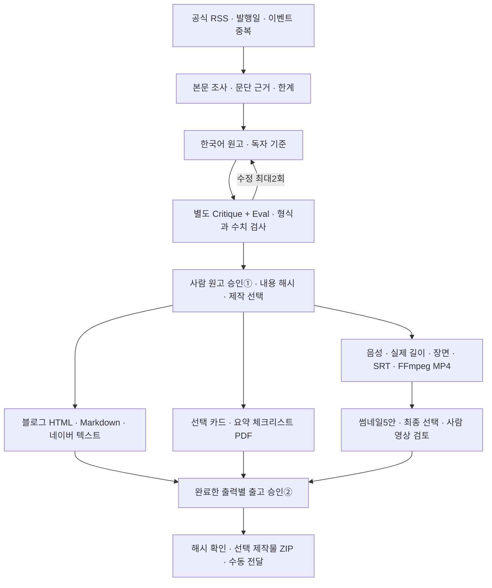

# HeoBrain 콘텐츠 오피스

공식 AI RSS에서 기사를 고르고, 근거가 연결된 한국어 원고를 검토한 뒤 블로그와 YouTube Shorts를 제작하는 개인용 로컬 앱입니다. 현재 작업실은 **http://localhost:3110**, API는 **http://localhost:8510/api/health**입니다. Windows 브라우저에서도 두 주소의 응답을 확인했습니다.

이번 사용자 지정 작업 시간은 **2026-10-26 02:20–08:20 KST**, 외부 API 총한도는 **10,000원**입니다. 앱 장부의 비용은 제공자 사용량과 확인한 단가를 이용한 추정 원가이며 계정 청구서 대사 금액이 아닙니다. 예산 환산 가정은 1달러=2,000원으로, 시장 환율을 뜻하지 않습니다.

## 처음 사용하는 순서

1. **오늘의 뉴스**에서 공식 RSS의 발행일·선정 이유·수집 실패를 확인합니다. 최근 7일의 날짜가 확인된 후보 중 최대3편을 작업으로 만듭니다. 초기 실제 선정3편은 이미 원고 검토 상태로 준비했습니다.
2. **콘텐츠 작업실**에서 원문 링크, 주장별 근거, 한계, 원고와 영상 대본을 읽습니다. 원문 접근이 막힌 경우 허용된 공개 본문을 직접 넣을 수 있습니다. 이때 선택한 본문만 지정 Gemini로 전송해 근거·원고를 다시 만들며, 과거 기획서 전체를 업로드하지 않습니다.
3. 수정한 원고는 새 버전으로 저장하고 비평·평가를 다시 받습니다. 영상·글·카드·PDF를 선택한 뒤 사람이 **원고 승인①**을 합니다. 승인 전에는 음성·이미지·영상 제작을 시작하지 않습니다.
4. **선택 제작**을 실행합니다. 글과 영상은 승인한 같은 원고에서 나뉩니다. 영상 실패가 완성된 글의 출고를 막지 않으며, 출력별 완료/실패와 남은 행동을 확인합니다.
5. **제작·출고함**에서 완료된 출고 대상만 고릅니다. 영상은 실제 음성·화면·자막을 확인하고 썸네일5안 중 최종안을 선택합니다. **출고 승인②** 뒤 선택한 제작물만 ZIP으로 내려받습니다.
6. 패키지를 플랫폼 편집기에 직접 전달합니다. 앱의 다운로드·출고 승인은 외부 공개 완료를 뜻하지 않습니다. 계정·일정·상품 조건과 실제 게시 결과는 플랫폼에서 확인합니다.

작업이 실패하면 **운영 기록**에서 현재 버전의 실패/부분 완료를 명시적으로 재시도할 수 있습니다. 모델 응답이 불명인 경우는 먼저 비용·결과를 대사해야 합니다. 같은 불명 호출은 재시도 버튼을 눌러도 제공자 연결부에서 차단하며, 열린 예약을 자동으로 지우지 않습니다.

## 실제 구현한 파이프라인



- **수집:** RSS/Atom, HTTPS 공개 주소, 응답 크기/리다이렉트 제한, 날짜 없음·미래 날짜 제외, URL 및 구체적 동일 이벤트 묶기. 실패 피드를 기사0개와 구분합니다.
- **조사:** 실제 본문에서 문단을 추출합니다. 모델의 근거 후보에 정확한 원문 문단을 붙이며, 단일 발행자 본문을 읽었다는 사실을 ‘독립 검증’으로 승격하지 않습니다. 링크 존재와 주장의 논리적 지지는 별도 검토 대상입니다.
- **작성:** Gen → 별도 Critique/Eval → Refine 최대2회. 두 검수 호출은 서로의 답변을 받지 않습니다. 현재 같은 모델의 별도 호출이므로 독립적인 외부 사실 증명으로 해석하지 않습니다.
- **버전:** 실제 모델 입력·schema·모델·옵션을 캐시에 묶습니다. 원고/제작 선택 변경은 관련 승인과 현재 제작물을 무효화합니다. 예전 원고는 버전 장부에 남습니다.
- **제작:** 블로그와 영상은 서로의 공개를 기다리지 않습니다. 성공한 음성은 즉시 보존하고 재사용합니다. 코드·폰트·음성 설정이 달라지면 새 제작 폴더에 보존합니다. 실제 음성60초 초과/무음/잘못된 스트림은 차단합니다.
- **출고:** 선택한 완료 출력에만 승인·ZIP을 적용합니다. 파일 내용 해시와 부모 원고를 다시 확인합니다. 영상 출고에는 썸네일 선택 및 음성·영상 검토 확인이 필요합니다.
- **운영:** SQLite WAL, 영속 큐, OS 단일 작업자 lock, 강제 종료 작업의 unknown 전환, 예산 원자 예약, 명시적 재시도, 고정 마감 감시를 구현했습니다.
- **과거 지식:** 원본111개 Markdown/고유103개/3,192절을 로컬 검색할 수 있습니다. 검색 결과는 과거 계획·근거이며 현재 지시나 실행 권한이 아닙니다.

세부 연결은 [이전 파이프라인→실제 구현표](docs/pipeline-traceability.md), [기존 소스 재사용과 미연결 범위](docs/reference-reuse.md)를 참고합니다.

## 결과 파일

| 선택 | 생성되는 결과 |
|---|---|
| 블로그 | `tistory.md`, `tistory.html`, `naver.txt` |
| 영상 | `youtube-script.md`, `youtube-plan.json`, `description.txt`, 장면별 WAV/PNG, `captions.srt`, `short.mp4`, 가로 썸네일5안, 세로 `shorts-cover.png`, `media.json` |
| 카드 | 승인 장면별 PNG와 검수 메타데이터 |
| 무료 자료 | `summary-checklist.pdf` |
| 공통 | `asset-rights.json`, 출력별 상태·파일 해시·부모 원고를 가진 manifest |
| 출고 승인 후 | 선택 제작물과 `handoff.json`을 포함한 ZIP |

MP4는1080×1920 H.264/AAC입니다. SRT는 실제 장면 음성 길이에 연결합니다. 생성된 커버·SRT 파일이 YouTube에 적용됐다는 뜻은 아닙니다. 썸네일 점수는 로컬 가독성·대비·원고 표현 일치 검사이며 실제 CTR 예측이나 성과 측정이 아닙니다.

## 실행과 종료

현재 작업실이 열려 있다면 중복으로 시작할 필요가 없습니다. Linux(EC2) 환경에서 서비스가 모두 종료된 뒤 시작하는 명령입니다. WSL은 더 이상 지원 대상이 아니며, Windows는 아래 PowerShell 절차를 따릅니다.

```bash
cd "<저장소 경로>/apps/content-office"
./scripts/start-local.sh
```

관리 스크립트는 자기 PID·시작 시각·명령과 포트 사용을 확인합니다. 기존에 수동으로 시작한 서비스를 강제로 빼앗지 않습니다. 전체 서비스 종료는 다음 명령입니다.

```bash
./scripts/stop-local.sh --all
```

`--worker`, `--watcher`로 관리 대상만 종료할 수도 있습니다. watcher를 수동 종료하는 것은 약속한 감시를 중단하는 일이므로, 이번08:20 종료 전에는 그대로 유지합니다.

08:20에는 작업자·자동 RSS 감시·새 유료 호출을 멈추고 검토 화면은 열어둡니다. 나중에 운영자가 새 작업 시간을 직접 지정할 수 있습니다. **기존 비용·불명 예약·총한도는 초기화하지 않습니다.** 현재 진행 중인 시간을 이 명령으로 조용히 연장할 수 없습니다.

```bash
cd "<저장소 경로>/apps/content-office/backend"
.venv/bin/python -m office.session status
# 기존 작업자와 감시의 종료를 확인한 뒤, 운영자가 직접 실행:
.venv/bin/python -m office.session start --minutes 60
```

그다음 별도 터미널에서 작업자와 감시를 시작합니다. 이미 열린 API·화면을 다시 시작할 필요는 없습니다.

```bash
cd "<저장소 경로>/apps/content-office/backend"
.venv/bin/python -m office.worker
```

```bash
cd "<저장소 경로>/apps/content-office"
backend/.venv/bin/python scripts/watch_window.py
```

### Windows PowerShell 5.1

Windows에서는 Linux 가상환경·`node_modules`를 재사용하지 않고 Python3.12+, Node22+, FFmpeg/ffprobe와 한국어 TTF를 준비합니다. 앱 폴더에서 네이티브 의존성과 화면 빌드를 설치합니다. 아래 자리표시자는 본인 로컬 절대 경로로 바꿉니다.

```powershell
Set-Location '<저장소 경로>\apps\content-office'
& 'C:\Python312\python.exe' -m venv backend\.venv
& .\backend\.venv\Scripts\python.exe -m pip install -r backend\requirements-lock.txt
Push-Location frontend
npm ci
npm run build
Pop-Location
$officeState = '<로컬 NTFS 상태 폴더 절대 경로>'
.\scripts\start-windows.ps1 -StateDir $officeState
.\scripts\status-windows.ps1 -StateDir $officeState
.\scripts\stop-windows.ps1 -StateDir $officeState
```

`-ProjectRoot`는 `backend`, `frontend`, `scripts`가 있는 앱 폴더이며 기본값은 스크립트 상위 폴더입니다. 모든 명령에서 같은 `-StateDir`를 명시합니다. 산출물 경로는 상태 폴더 아래로 약 160자가 더 붙으므로(`artifacts\job_<16자>\<64자 해시>\production-<24자>\파일`), Windows 긴 경로 설정이 꺼져 있으면 `-StateDir`는 99자 이하여야 하며 실행기가 더 길면 시작을 거부합니다. 더 긴 경로를 쓰려면 레지스트리 `HKLM:\SYSTEM\CurrentControlSet\Control\FileSystem`의 `LongPathsEnabled`를 1로 두고 재시작합니다. 같은 이유로 저장소도 짧은 경로(예: `C:\dev\...`)에 두는 것이 안전합니다. API8510·화면3110은 `127.0.0.1`에만 열립니다. `-NodePath`로 네이티브 `node.exe`를 지정할 수 있습니다. 기본 검색 순서는 `C:\nvm4w\nodejs`, Program Files, PATH입니다. 실행기가 이미 관리하는 서비스는 중복 시작하지 않습니다. 수동 실행 서비스가 포트를 사용하면 그대로 두고 시작을 거부합니다.

시작 기본값은 API와 화면뿐입니다. **기존 승인 작업 시간이 열려 있을 때만** `-Worker`, `-Watcher`로 각각 명시적으로 추가합니다. 실행기는 작업 시간·비용·예약을 초기화하거나 연장하지 않습니다. 화면이 이미 열려 있어도 같은 명령으로 작업자·감시를 추가할 수 있습니다. 새 작업 시간은 위의 운영자 CLI 절차에 따라 따로 승인합니다. 작업자와 감시는 함께 실행하는 것을 권합니다.

```powershell
.\scripts\start-windows.ps1 -StateDir $officeState -Worker -Watcher
.\scripts\stop-windows.ps1 -StateDir $officeState -Service worker
```

`-Service all|api|frontend|worker|watcher`로 종료 대상을 고릅니다. 종료는 저장한 프로젝트·PID·네이티브 시작 시각·실행 파일·명령이 모두 일치할 때만 요청합니다. Windows 종료는 해당 프로세스를 강제 종료하므로 진행 중인 작업은 재시작 뒤 장부의 `unknown` 상태와 비용 예약을 먼저 확인합니다. 작업 시간이 끝나기 전에 감시를 직접 중지하면 약속한 감시도 중단됩니다. 관리 기록과 각 서비스의 stdout/stderr는 상태 폴더의 `runtime`에 보존됩니다. 상태 명령은 프로세스 소유권을 보여주며 HTTP 응답 성공은 별도로 확인합니다.

자격 정보가 필요하면 로컬에 보관한 UTF-8 환경 파일을 `-EnvFile '<로컬 환경 파일>'` 또는 `OFFICE_ENV_FILE`로 지정합니다. `KEY=value`, `export KEY=value`, 한 쌍의 따옴표와 `#` 주석 행을 지원하며 값은 문자 그대로 읽습니다. 셸 명령·변수 치환·여러 줄 값은 지원하지 않습니다. 기존 환경을 자식에게 전달하고 호출한 PowerShell의 환경은 복원합니다. 파일 내용과 전체 환경은 관리 기록에 저장하지 않습니다. 환경 파일·상태 폴더·로그는 공개 폴더나 저장소에 넣지 않습니다.

분리된 검증 포트에서는 화면이 연결할 API 주소도 함께 바꿉니다. Next.js의 production rewrite는 **빌드할 때** 정해지므로 아래 환경값으로 다시 빌드한 뒤 같은 포트로 시작합니다. `-FrontendMode development`를 명시하면 개발 화면을 사용할 수도 있습니다.

```powershell
$env:OFFICE_API_URL = 'http://127.0.0.1:18510'
Push-Location frontend
npm run build
Pop-Location
.\scripts\start-windows.ps1 -StateDir '<별도 검증 상태 폴더>' -ApiPort 18510 -FrontendPort 13110
```

운영 포트로 되돌릴 때는 `OFFICE_API_URL`을 제거하거나 `http://127.0.0.1:8510`으로 바꿔 다시 빌드합니다. 실행 중인 관리 서비스의 포트를 바꾸려면 먼저 해당 서비스들을 종료합니다. 실행기가 만든 프로세스는 시작 직후만 확인하므로 브라우저와 `/api/health`를 확인한 뒤 사용합니다.

### Linux(EC2)

Linux에서는 `scripts/start-local.sh`, `scripts/stop-local.sh`와 위의 `.venv/bin/python` 절차를 그대로 씁니다. 기본 음성은 Windows System.Speech(`Microsoft Heami Desktop`)라 Linux에서는 생성되지 않으므로, 영상을 만들기 전에 운영자가 `office.voice_selection set --profile gemini-kore`로 유료 음성 프로필을 명시적으로 선택해야 합니다. 생성 배경을 쓰려면 환경 파일에 운영자의 `OPENAI_API_KEY`를 넣고 `office.image_selection set --profile openai-gpt-image`를 선택합니다. 한국어 폰트는 `CONTENT_OFFICE_FONT` 또는 `/usr/share/fonts/opentype/noto/NotoSansCJK-Regular.ttc`(예: `fonts-noto-cjk` 패키지)를 준비합니다. FFmpeg/ffprobe는 PATH에 있어야 합니다.

## 의존성과 설정

이 작업공간에는 Python 가상환경·Node 의존성과 FFmpeg가 준비됐습니다. 새 환경에 설치할 때는 Python3.12+, Node22+, FFmpeg/ffprobe, 한국어 TTF 폰트를 준비합니다. Windows 기본 음성 경로에는 PowerShell과 `Microsoft Heami Desktop` ko-KR 음성이 필요합니다.

```bash
cd apps/content-office
python3 -m venv backend/.venv
backend/.venv/bin/python -m pip install -r backend/requirements-lock.txt
cd frontend
npm ci
npm run build
```

| 설정 | 의미 |
|---|---|
| `GEMINI_API_KEY` | 기존 Gemini 연결. 환경으로만 전달하며 UI·ZIP·저장소에 넣지 않습니다 |
| `OPENAI_API_KEY` | 배경 이미지 프로필 `openai-gpt-image`를 고른 경우에만 필요합니다. 실행하는 운영자가 자신의 키를 환경 파일에 넣으며, 영수증·UI·ZIP·저장소에 기록하지 않습니다 |
| `OFFICE_STATE_DIR` | DB·자산·캐시 위치. 기본 `~/.local/state/heobrain-content-office` |
| `OFFICE_MODEL` | 새 장부의 명시적 모델 선택. 현재 실제 작성에 검증한 모델은 `gemini-3.5-flash-lite`이며 저장된 모델 설정이 우선합니다 |
| `CONTENT_OFFICE_FONT` | 한국어 TTF 경로. 이 환경은 Windows Malgun Gothic을 사용하며 폰트 파일을 배포하지 않습니다 |
| `OFFICE_LOCAL_VOICE` | 명시적인 설치 음성 이름. 기본 `Microsoft Heami Desktop`, rate0 |
| `OFFICE_ENV_FILE` | start-local에 필요한 본인 소유 환경 파일을 지정할 때만 사용합니다 |

음성 프로필은 운영자가 명시적으로 선택합니다. 로컬 Heami와 실제 합성 자료에서 시험한 Gemini3.8 Flash TTS/Kore를 제공합니다. Gemini 경로도 원고 승인① 후 승인된3~7장면 대본에만 호출하며, 원고당1,000원 하위한도와 기존 총10,000원 한도를 함께 적용합니다. 요청이 실패해도 다른 유료 음성으로 자동 전환하지 않습니다. 실제 음성/전사 비교는 아래 조사 폴더의 음성 품질 보고서에 있으며, 자동 전사 차이가 주관적 청취 품질 보증은 아닙니다.

```bash
cd "<저장소 경로>/apps/content-office/backend"
.venv/bin/python -m office.voice_selection status
# 선택 자체는 유료 호출을 하지 않습니다.
.venv/bin/python -m office.voice_selection set --profile gemini-kore
# 로컬을 명시적으로 고르려면:
.venv/bin/python -m office.voice_selection set --profile windows-heami
```

배경 이미지 프로필도 같은 방식으로 운영자가 명시적으로 선택합니다. 기본값 `none`은 지금처럼 글자 카드만 그립니다. `openai-gpt-image`를 고르면 원고 승인① 후 영상·카드 출력의 장면마다 OpenAI `gpt-image-2.5-flare`(1024×1536, medium)로 배경 한 장을 받고, 제목·수치·단계 같은 한국어 글자는 그 위에 로컬 Pillow 레이어로 얹습니다. 생성 이미지에 글자를 맡기지 않습니다. 장당 200원을 예약하고 공식 사용량으로 정산하며, 업무당 2,000원 하위한도와 총 10,000원 한도를 함께 적용합니다. 키가 없거나 호출이 실패하면 해당 출력만 실패로 남기고 블로그 같은 독립 출력과 성공한 자산은 보존합니다. 다른 제공자로 자동 전환하지 않으며, 글자 카드로 돌아가려면 프로필을 `none`으로 바꾼 뒤 다시 제작을 요청합니다. 같은 장면의 완료 영수증이 있으면 재호출 없이 재사용합니다. 단가는 2026-10-28 공식 가격표 기준이고 2026-11-04까지 유효합니다.

```bash
cd "<저장소 경로>/apps/content-office/backend"
.venv/bin/python -m office.image_selection status
# 선택 자체는 유료 호출을 하지 않습니다. 키 존재 여부만 configured로 표시합니다.
.venv/bin/python -m office.image_selection set --profile openai-gpt-image
.venv/bin/python -m office.image_selection set --profile none
```

유료 모델을 사용할 수 없거나 단가 검증 기간이 지나면 보류합니다. 자동 유료 대체 호출은 없습니다. 외부 모델로 원본111문서·Windows 소스·자격 파일을 통째 전송하지 않습니다. 배경 이미지 프롬프트에는 승인된 장면의 자막과 시각 지시만 들어갑니다.

## 검사와 증거

```bash
cd apps/content-office/backend
.venv/bin/python -m pytest -q
# Windows 실제 한국어 음성·FFmpeg까지 포함하는 별도 합성 자료 검사:
OFFICE_REAL_MEDIA_E2E=1 .venv/bin/python -m pytest tests/test_e2e_workflow.py -q
```

```bash
cd apps/content-office/frontend
npm test
npm run typecheck
npm run test:ui
npm run build
```

Windows 실행기 회귀 검사는 PowerShell 5.1에서 임시 폴더와 유료 호출 없는 가짜 서비스만 사용합니다. `-NodePath`를 주면 기본 실행·작업자/감시 추가·선택 종료까지 검사하며, 생략하면 환경·인수·잠금·포트·경로 길이·프로세스 소유권을 검사합니다.

백엔드 테스트는 로케일에 의존하지 않도록 모든 텍스트 입출력에 UTF-8을 명시하므로 한국어 Windows(cp949)에서도 `PYTHONUTF8` 없이 통과합니다. FFmpeg/ffprobe가 없으면 영상 렌더링 테스트 7개가 이유와 함께 스킵되고, Windows 개발자 모드가 꺼져 있으면 symlink 테스트 3개가 스킵됩니다. 영상 경로까지 검증하려면 FFmpeg를 PATH에 두고 다시 실행합니다.

```powershell
.\scripts\tests\windows-launchers.test.ps1 -TestRoot $env:TEMP -PythonPath 'C:\Python312\python.exe' -NodePath '<네이티브 node.exe 절대 경로>'
```

검증 기록은 프로젝트 `research/content-office-2026-10-26/`에 있습니다. 실제 합성 자료의 브라우저→API→SQLite→음성/MP4→출고→ZIP→재시작 증거는 `e2e-report.md`, 원본 문서/참고 소스 범위는 `md-audit.md`, `research-md-audit.md`, `source-audit.md`에 있습니다. 검사는 실제 뉴스3편의 승인·제작·공개 완료를 대신하지 않습니다.

## 이번 경계

현재는 한 컴퓨터의 단일 운영자용입니다. 로컬 세션·Origin/CSRF·경로·파일 해시를 검사하지만, 원격 고객의 계정 인증·다중 사용자 자료 격리를 구현한 서비스는 아닙니다. Hermes native runtime, 기존 Windows 엔진 전체, 외부 플랫폼 업로드, 뉴스레터 발송, Marketplace 상품/쿠폰/주문 쓰기는 연결하지 않았습니다. 이 연결 없이도 선택·원고 검토·승인·제작·수동 전달을 사용할 수 있습니다.

판매 자료·타사 자산·폰트·음성의 실제 사용 조건은 출고 목적에 맞춰 검토합니다. 상품을 임의로 끼워 넣거나 가격·쿠폰·다운로드 권한을 AI가 바꾸지 않습니다. 현재 기능과 전체 장기 계획을 구분한 범위는 두 연결 문서에 기록했습니다.

v6 편집 통제실은 화면에서 끝까지 이어집니다. 기획에서 시작한 작업은 패키지(제목 3안·썸네일 3안·훅)를 확정하기 전에는 원고를 만들지 않고, 게이트에 걸리면 원고 품질을 blocked로 표시할 뿐 사람의 승인을 대신하지 않습니다. 기획 선택에는 https 출처 URL이 필요합니다. 포맷 분기·TTS 발음 사전은 아직 연결되지 않았습니다.

1. **오늘의 뉴스 → 기획 은행**: "기획 직접 등록"에 제목·출처 URL(https)·조회수·수요·1차 출처 수·적합도를 넣으면 점수와 막힌 이유가 붙습니다. "이 기획으로 작업 만들기"가 ⓪ 기획 선택입니다.
2. **콘텐츠 작업실 → 패키지 카드**: 제목 3안·썸네일 3안·훅·로그라인·통할 이유를 넣고 확정합니다. 확정 전에는 "원고 생성 시작"이 눌리지 않습니다. 원고 승인 뒤 패키지를 바꾸면 원고가 이전 패키지로 작성됐다는 안내가 뜹니다.
3. **원고 생성 → 독립 검수 패널**: 품질·정책 게이트 결과(통과·경고·차단)와 사유가 보입니다. ① 원고 승인은 여기서 사람이 합니다.
4. **운영 기록 → 성과**: YouTube Studio "콘텐츠" 표 CSV를 채널·기간과 함께 올리면 스냅샷이 저장되고 교훈 후보가 생깁니다. 교훈은 "승인"을 눌러야만 기획 점수 가중치에 반영됩니다.

**오피스 월드**(메뉴 "오피스 월드")는 같은 앱이 `/world/`로 제공하는 3D 관제 공간입니다. 백엔드 `GET /api/space`가 방 5개(오늘의 뉴스·원고 작업실·제작 스튜디오·제작·출고함·운영 기록)와 동료·이벤트·흐름을 제목·상태·담당만으로 투영하고, 공간은 10초마다 다시 읽습니다. 앱에서 작업을 고르면 공간이 그 방으로 이동하고, 공간의 "오피스에서 열기"는 앱의 해당 화면으로 돌아옵니다. 공간의 버튼은 원고 생성·제작 시작 같은 요청만 앱에 보내며, 승인(⓪·①·②·③)은 앱 화면에서만 합니다. 투영에는 원문·근거·파일 경로가 들어가지 않습니다.
