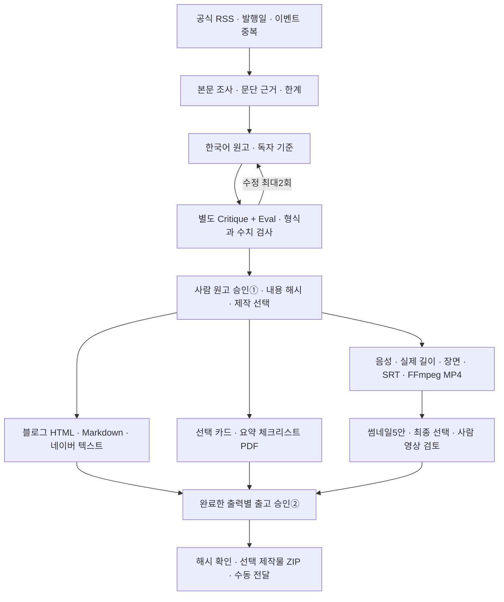

# HeoBrain 콘텐츠 오피스

공식 AI RSS와 직접 등록한 기획에서, 독자·근거가 연결된 원고를 검토하고 블로그와 YouTube Shorts를 제작하는 운영자용 앱입니다. Windows와 EC2에서 실행하며 기본 loopback 주소는 작업실 **http://localhost:3110**, API **http://localhost:8510/api/health**입니다. EC2의 외부 주소와 인증은 별도 운영 설정으로 관리합니다.

아래 2026-10-26 작업 시간·예산은 초기 실험 기록입니다. 현재 제작 허가는 앱에 저장된 작업 시간과 원고·출고 승인을 확인합니다. 개발·검증 시간을 요청해도 제작 작업 시간이나 예산이 자동으로 열리지 않습니다.

이번 사용자 지정 작업 시간은 **2026-10-26 02:20–08:20 KST**, 외부 API 총한도는 **10,000원**입니다. 앱 장부의 비용은 제공자 사용량과 확인한 단가를 이용한 추정 원가이며 계정 청구서 대사 금액이 아닙니다. 예산 환산 가정은 1달러=2,000원으로, 시장 환율을 뜻하지 않습니다.

## 화면 주소와 뉴스 분류

- `/`: 내 결정 대기. 기획⓪·원고①·출고②·회차③의 검토 위치로 이동합니다. 초안 수를 승인 완료로 표시하지 않습니다.
- `/news?seg=all|exam|ai`: 최근 7일 후보를 전체·자격증/수험생·AI/자동화로 구분합니다. URL과 이 브라우저의 마지막 분류를 기억합니다. 숫자는 표시 가능한 전체 후보 수이며 오늘 새 기사나 미처리 수가 아닙니다.
- `/plans`: 독자 질문과 기획 은행. `/scripts/<jobId>`는 원고·제작 선택, `/publish?job=<jobId>`는 출고 검토 작업의 공유 주소입니다.
- `/settings`, `/runs`, `/pipeline`, `/office3d`: 제작 설정·운영 기록·공정도·월드 보기. 기존 `/world/` 자산 경로는 유지합니다.

App Router의 공통 레이아웃이 기존 작업실 상태를 유지합니다. 보기 전환·뒤로가기는 뉴스 선택과 상위 편집 초안을 보존하지만, 새로고침은 저장되지 않은 입력을 지울 수 있으므로 기존 경고에 따라 먼저 저장합니다. 세부 패널을 화면별 페이지로 완전히 분리하는 작업은 후속입니다.

뉴스 출처 메타데이터는 `backend/config/feeds.json`에서 관리합니다. 분류·언어·주제를 명시하고, 등록되지 않은 출처는 미분류로 남깁니다. 기존 저장 기사의 분류는 조회 때 보강하며 운영 기사 원본을 다시 쓰지 않습니다. 현재 등록된 10개는 AI 출처입니다. 자격증 출처 수집은 아직 연결하지 않았으므로 빈 분류를 뉴스가 있다고 꾸미지 않습니다. 미수집·수집 실패·소스 미등록·필터 결과 0·유효 후보 없음은 서로 다른 문구로 표시합니다.

## 처음 사용하는 순서

1. **오늘의 뉴스**에서 공식 RSS의 발행일·선정 이유·수집 실패를 확인합니다. 최근 7일의 날짜가 확인된 후보 중 최대3편을 작업으로 만듭니다. 초기 실제 선정3편은 이미 원고 검토 상태로 준비했습니다.
2. **콘텐츠 작업실**에서 원문 링크, 주장별 근거, 한계, 원고와 영상 대본을 읽습니다. 원문 접근이 막힌 경우 허용된 공개 본문을 직접 넣을 수 있습니다. 이때 선택한 본문만 현재 선택한 글 모델로 전송해 근거·원고를 다시 만들며, 과거 기획서 전체를 업로드하지 않습니다. 기획 출신 작업은 제목·썸네일·후크를 먼저 정해야 원문 등록을 요청할 수 있습니다. 미확정 상태에서도 입력은 보존합니다.
3. 수정한 원고는 새 버전으로 저장하고 비평·평가를 다시 받습니다. 영상·글·카드·PDF를 선택한 뒤 사람이 **원고 승인①**을 합니다. 승인 전에는 음성·이미지·영상 제작을 시작하지 않습니다.
4. **선택 제작**을 실행합니다. 글과 영상은 승인한 같은 원고에서 나뉩니다. 영상 실패가 완성된 글의 출고를 막지 않으며, 출력별 완료/실패와 남은 행동을 확인합니다.
5. **제작·출고함**에서 완료된 출고 대상만 고릅니다. 영상은 실제 음성·화면·자막을 확인하고 썸네일5안 중 최종안을 선택합니다. **출고 승인②** 뒤 선택한 제작물만 ZIP으로 내려받습니다.
6. 패키지를 플랫폼 편집기에 직접 전달합니다. 앱의 다운로드·출고 승인은 외부 공개 완료를 뜻하지 않습니다. 계정·일정·상품 조건과 실제 게시 결과는 플랫폼에서 확인합니다.

작업이 실패하면 **운영 기록**에서 현재 버전의 실패/부분 완료를 명시적으로 재시도할 수 있습니다. 모델 응답이 불명인 경우는 먼저 비용·결과를 대사해야 합니다. 같은 불명 호출은 재시도 버튼을 눌러도 제공자 연결부에서 차단하며, 열린 예약을 자동으로 지우지 않습니다.

## 실제 구현한 파이프라인



- **수집:** RSS/Atom, HTTPS 공개 주소, 응답 크기/리다이렉트 제한, 날짜 없음·미래 날짜 제외, URL 및 구체적 동일 이벤트 묶기. 실패 피드를 기사0개와 구분합니다.
- **조사:** 실제 본문에서 문단을 추출합니다. 모델의 근거 후보에 정확한 원문 문단을 붙이며, 단일 발행자 본문을 읽었다는 사실을 ‘독립 검증’으로 승격하지 않습니다. 링크 존재와 주장의 논리적 지지는 별도 검토 대상입니다.
- **작성:** Gen → 별도 Critique/Eval → Refine 최대2회. 두 검수 호출은 서로의 답변을 받지 않습니다. 현재 같은 모델의 별도 호출이므로 독립적인 외부 사실 증명으로 해석하지 않습니다.
- **버전:** 실제 모델 입력·schema·모델·옵션을 캐시에 묶습니다. 원고/제작 선택 변경은 관련 승인과 현재 제작물을 무효화합니다. 예전 원고는 버전 장부에 남습니다.
- **제작:** 블로그와 영상은 서로의 공개를 기다리지 않습니다. 성공한 음성은 즉시 보존하고 재사용합니다. 코드·폰트·음성 설정이 달라지면 새 제작 폴더에 보존합니다. 실제 음성60초 초과/무음/잘못된 스트림은 차단합니다.
- **출고:** 선택한 완료 출력에만 승인·ZIP을 적용합니다. 파일 내용 해시와 부모 원고를 다시 확인합니다. 영상 출고에는 썸네일 선택 및 음성·영상 검토 확인이 필요합니다.
- **운영:** SQLite WAL, 영속 큐, OS 단일 작업자 lock, 강제 종료 작업의 unknown 전환, 예산 원자 예약, 명시적 재시도, 고정 마감 감시를 구현했습니다.
- **과거 지식:** 원본111개 Markdown/고유103개/3,192절을 로컬 검색할 수 있습니다. 검색 결과는 과거 계획·근거이며 현재 지시나 실행 권한이 아닙니다.

세부 연결은 [이전 파이프라인→실제 구현표](docs/pipeline-traceability.md), [기존 소스 재사용과 미연결 범위](docs/reference-reuse.md)를 참고합니다.

## 상품·쿠폰 캠페인을 앱에서 이어가는 방법

콘텐츠 작업실의 **구매 링크와 쿠폰**은 이 작업의 캠페인 스냅샷입니다. 스토어 가격·쿠폰을 발급하거나 결제를 실행하는 기능이 아닙니다. 쿠폰은 코드·할인율·시간대 있는 만료·사용 조건과 운영자 확인을 기록합니다. 조건 미정은 저장할 수 있지만 생성·승인·출고에 유효 쿠폰처럼 사용할 수 없습니다. 기준 가격의 할인 예상액은 계산값이며 실제 결제금액과 별개입니다.

오퍼 내용 변경·삭제는 현재 원고 해시와 관련 승인①②·현재 제작물을 무효화합니다. 다른 탭의 최신 조건을 덮어쓰지 않도록 `expected_offer_hash`를 요구합니다. 기존 승인 원고에 상품 안내가 없으면 상품 기록만 붙여 예전 영상을 전송할 수 없습니다. 새 조건을 반영한 원고와 영상 마지막 CTA 장면을 재검수한 뒤 사람이 다시 승인합니다. 생성 전에 입력한 캠페인은 글 모델의 근거·비평/평가 입력에도 전달됩니다.

블로그 선택에는 **블로그·소셜 검토초안**이 포함됩니다. 승인 본문의 문단을 그대로 발췌한 X·Threads·LinkedIn 문구와 Instagram 캡션5개 및 `channel-handoff.json`을 같은 원고 해시·제작 manifest에 연결합니다. 글자 수·언어·주소·영상/이미지 검토가 필요하면 `needs_review`로 남깁니다. 새 경험·주장·영어 번역을 만들지 않으며 플랫폼 임시저장함·예약 게시를 생성하지 않습니다. 출고 승인②에서 블로그를 선택한 경우에만 이 파일들이 ZIP에 들어갑니다.

제작·출고함의 채널 표에서 **제작 파일 없음 / 앱 검토 파일 있음 / 현재② 출고 묶음 / 외부 전송 결과**를 구분합니다. YouTube 비공개 업로드는 현재②·실제 채널 자격·발행 허용·원고 언어·작업 시간이 모두 필요합니다. 응답의 `privacyStatus=private`와 외부 ID를 확인하기 전에는 완료로 표시하지 않습니다. 불명 결과는 같은 영상을 새로 올리지 않고 기존 외부 ID·세션으로 대사합니다. 조건·쿠폰·원고·파일이 바뀌면 이전 승인으로 영상 바이트를 보내지 않습니다.

스토어 쿠폰 발급/실제 결제, 다른 플랫폼의 임시저장·예약·공개 API, 뉴스레터 자동 발송은 별도 운영 작업 또는 미구현입니다. 원고①·출고②·회차③을 에이전트가 대신 승인하지 않습니다. YouTube 채널 연결(OAuth 로그인)은 아래 "YouTube 채널 연결" 절에 구현돼 있으나 실제 Google 계정으로 끝까지 검증하지는 않았습니다.

2D 목록은 `/api/dashboard?compact=true`로 원고 본문 없이 필요한 작업 메타데이터만 받습니다. 기본 `/api/dashboard`의 기존 응답 계약은 유지하며 오래된 작업 ID를 목록에서 잘라내지 않습니다. 상세 원고는 선택한 작업 GET에서 읽습니다. 목록 갱신은 겹치지 않고, 화면 복귀·명시 갱신 뒤 예전 성공/실패 응답이 최신 상태를 덮지 못합니다. 이 변경의 전송량 감소는 실제 FPS·DB 속도 향상을 뜻하지 않습니다.

## 결과 파일

| 선택 | 생성되는 결과 |
|---|---|
| 블로그 | `tistory.md`, `tistory.html`, `naver.txt` |
| 영상 | `youtube-script.md`, `youtube-plan.json`, `description.txt`, 장면별 WAV/PNG, `captions.srt`, `short.mp4`, 가로 썸네일5안, 세로 `shorts-cover.png`, `media.json` |
| 카드 | 승인 장면별 PNG와 검수 메타데이터 |
| 무료 자료 | `summary-checklist.pdf` |
| 공통 | `asset-rights.json`, 출력별 상태·파일 해시·부모 원고를 가진 manifest |
| 출고 승인 후 | 선택 제작물과 `handoff.json`을 포함한 ZIP |
| 생성 배경·영상 선택 시 | 장면별 `background-NN.png`, 생성 장면의 `generated-NN.mp4`와 글자 레이어 `overlay-NN.png`, manifest의 `background`·`clips` 고지 |
| YouTube 비공개 업로드 후 | 상태 폴더 설정의 업로드 장부(`deliveries`): 상태·외부 ID·자산 해시·대사 시각 |

출고 ZIP은 ②에서 승인하고 선택한 manifest 파일만 담습니다. 별도로 생성한 최신 퀴즈 JSON·카드뉴스 초안을 자동 첨부하지 않습니다. 카드뉴스의 **전체 ZIP 내려받기**는 현재 화면의 버전·원고 해시와 일치하는 6~8장 PNG 및 검토 명세를 묶는 별도 검토 ZIP입니다. 검사 경고는 명세에 남기고 출고 승인②를 대신하지 않습니다. 누락·중복 이미지·변조·이전 원고·버전 변경은 다운로드를 막습니다. 새 카드 PNG는 기존 글자 배치를 보존한 1080×1440(3:4)이며 미리보기는 이미지를 자르지 않습니다. 초안을 다시 만들거나 초안 파일이 손상돼도 이미 승인된 ZIP의 구성원별 내용 해시는 달라지지 않습니다.

MP4는1080×1920 H.264/AAC입니다. SRT는 실제 장면 음성 길이에 연결합니다. 생성된 커버·SRT 파일이 YouTube에 적용됐다는 뜻은 아닙니다. 썸네일 점수는 로컬 가독성·대비·원고 표현 일치 검사이며 실제 CTR 예측이나 성과 측정이 아닙니다.

기존 정사각형 카드가 있는 작업도 카드 전용 검토 ZIP에서는 원본 픽셀을 보존해 1080×1440 사본으로 받습니다. 원본 파일·작업·승인·통합 검토 ZIP은 그대로 유지하며, `review.json`에 원본 해시와 내려받은 사본 해시를 구분합니다.

## 실행과 종료

현재 작업실이 열려 있다면 중복으로 시작할 필요가 없습니다. Linux(EC2) 환경에서 서비스가 모두 종료된 뒤 시작하는 명령입니다. WSL은 더 이상 지원 대상이 아니며, Windows는 아래 PowerShell 절차를 따릅니다.

```bash
cd "<저장소 경로>/apps/content-office"
./scripts/start-local.sh
```

관리 스크립트는 자기 PID·시작 시각·명령과 포트 사용을 확인합니다. 기존에 수동으로 시작한 서비스를 강제로 빼앗지 않습니다. 전체 서비스 종료는 다음 명령입니다.

```bash
./scripts/stop-local.sh --all
```

`--worker`, `--watcher`로 관리 대상만 종료할 수도 있습니다. watcher를 수동 종료하는 것은 약속한 감시를 중단하는 일이므로, 이번08:20 종료 전에는 그대로 유지합니다.

08:20에는 작업자·자동 RSS 감시·새 유료 호출을 멈추고 검토 화면은 열어둡니다. 나중에 운영자가 새 작업 시간을 직접 지정할 수 있습니다. **기존 비용·불명 예약·총한도는 초기화하지 않습니다.** 현재 진행 중인 시간을 이 명령으로 조용히 연장할 수 없습니다.

```bash
cd "<저장소 경로>/apps/content-office/backend"
.venv/bin/python -m office.session status
# 기존 작업자와 감시의 종료를 확인한 뒤, 운영자가 직접 실행:
.venv/bin/python -m office.session start --minutes 60
```

그다음 별도 터미널에서 작업자와 감시를 시작합니다. 이미 열린 API·화면을 다시 시작할 필요는 없습니다.

```bash
cd "<저장소 경로>/apps/content-office/backend"
.venv/bin/python -m office.worker
```

```bash
cd "<저장소 경로>/apps/content-office"
backend/.venv/bin/python scripts/watch_window.py
```

### Windows PowerShell 5.1

Windows에서는 Linux 가상환경·`node_modules`를 재사용하지 않고 Python3.12+, Node22+, FFmpeg/ffprobe와 한국어 TTF를 준비합니다. 앱 폴더에서 네이티브 의존성과 화면 빌드를 설치합니다. 아래 자리표시자는 본인 로컬 절대 경로로 바꿉니다.

```powershell
Set-Location '<저장소 경로>\apps\content-office'
& 'C:\Python312\python.exe' -m venv backend\.venv
& .\backend\.venv\Scripts\python.exe -m pip install -r backend\requirements-lock.txt
Push-Location frontend
npm ci
npm run build
Pop-Location
$officeState = '<로컬 NTFS 상태 폴더 절대 경로>'
.\scripts\start-windows.ps1 -StateDir $officeState
.\scripts\status-windows.ps1 -StateDir $officeState
.\scripts\stop-windows.ps1 -StateDir $officeState
```

`-ProjectRoot`는 `backend`, `frontend`, `scripts`가 있는 앱 폴더이며 기본값은 스크립트 상위 폴더입니다. 모든 명령에서 같은 `-StateDir`를 명시합니다. 산출물 경로는 상태 폴더 아래로 약 160자가 더 붙으므로(`artifacts\job_<16자>\<64자 해시>\production-<24자>\파일`), Windows 긴 경로 설정이 꺼져 있으면 `-StateDir`는 99자 이하여야 하며 실행기가 더 길면 시작을 거부합니다. 더 긴 경로를 쓰려면 레지스트리 `HKLM:\SYSTEM\CurrentControlSet\Control\FileSystem`의 `LongPathsEnabled`를 1로 두고 재시작합니다. 같은 이유로 저장소도 짧은 경로(예: `C:\dev\...`)에 두는 것이 안전합니다. API8510·화면3110은 `127.0.0.1`에만 열립니다. `-NodePath`로 네이티브 `node.exe`를 지정할 수 있습니다. 기본 검색 순서는 `C:\nvm4w\nodejs`, Program Files, PATH입니다. 실행기가 이미 관리하는 서비스는 중복 시작하지 않습니다. 수동 실행 서비스가 포트를 사용하면 그대로 두고 시작을 거부합니다.

시작 기본값은 API와 화면뿐입니다. **기존 승인 작업 시간이 열려 있을 때만** `-Worker`, `-Watcher`로 각각 명시적으로 추가합니다. 실행기는 작업 시간·비용·예약을 초기화하거나 연장하지 않습니다. 화면이 이미 열려 있어도 같은 명령으로 작업자·감시를 추가할 수 있습니다. 새 작업 시간은 위의 운영자 CLI 절차에 따라 따로 승인합니다. 작업자와 감시는 함께 실행하는 것을 권합니다.

```powershell
.\scripts\start-windows.ps1 -StateDir $officeState -Worker -Watcher
.\scripts\stop-windows.ps1 -StateDir $officeState -Service worker
```

`-Service all|api|frontend|worker|watcher`로 종료 대상을 고릅니다. 종료는 저장한 프로젝트·PID·네이티브 시작 시각·실행 파일·명령이 모두 일치할 때만 요청합니다. Windows 종료는 해당 프로세스를 강제 종료하므로 진행 중인 작업은 재시작 뒤 장부의 `unknown` 상태와 비용 예약을 먼저 확인합니다. 작업 시간이 끝나기 전에 감시를 직접 중지하면 약속한 감시도 중단됩니다. 관리 기록과 각 서비스의 stdout/stderr는 상태 폴더의 `runtime`에 보존됩니다. 상태 명령은 프로세스 소유권을 보여주며 HTTP 응답 성공은 별도로 확인합니다.

자격 정보가 필요하면 로컬에 보관한 UTF-8 환경 파일을 `-EnvFile '<로컬 환경 파일>'` 또는 `OFFICE_ENV_FILE`로 지정합니다. `KEY=value`, `export KEY=value`, 한 쌍의 따옴표와 `#` 주석 행을 지원하며 값은 문자 그대로 읽습니다. 셸 명령·변수 치환·여러 줄 값은 지원하지 않습니다. 기존 환경을 자식에게 전달하고 호출한 PowerShell의 환경은 복원합니다. 파일 내용과 전체 환경은 관리 기록에 저장하지 않습니다. 환경 파일·상태 폴더·로그는 공개 폴더나 저장소에 넣지 않습니다.

분리된 검증 포트에서는 화면이 연결할 API 주소도 함께 바꿉니다. Next.js의 production rewrite는 **빌드할 때** 정해지므로 아래 환경값으로 다시 빌드한 뒤 같은 포트로 시작합니다. `-FrontendMode development`를 명시하면 개발 화면을 사용할 수도 있습니다.

```powershell
$env:OFFICE_API_URL = 'http://127.0.0.1:18510'
Push-Location frontend
npm run build
Pop-Location
.\scripts\start-windows.ps1 -StateDir '<별도 검증 상태 폴더>' -ApiPort 18510 -FrontendPort 13110
```

운영 포트로 되돌릴 때는 `OFFICE_API_URL`을 제거하거나 `http://127.0.0.1:8510`으로 바꿔 다시 빌드합니다. 실행 중인 관리 서비스의 포트를 바꾸려면 먼저 해당 서비스들을 종료합니다. 실행기가 만든 프로세스는 시작 직후만 확인하므로 브라우저와 `/api/health`를 확인한 뒤 사용합니다.

### Linux(EC2)

Linux에서는 `scripts/start-local.sh`, `scripts/stop-local.sh`와 위의 `.venv/bin/python` 절차를 그대로 씁니다. 기본 음성은 Windows System.Speech(`Microsoft Heami Desktop`)라 Linux에서는 생성되지 않으므로, 영상을 만들기 전에 운영자가 `office.voice_selection set --profile openai-tts` 또는 `--profile gemini-kore`로 유료 음성 프로필을 명시적으로 선택해야 합니다. 생성 배경을 쓰려면 환경 파일에 운영자의 `OPENAI_API_KEY`를 넣고 `office.image_selection set --profile openai-gpt-image`를 선택합니다. 한국어 폰트는 TrueType(.ttf)이어야 합니다. PDF 생성기(reportlab)가 Noto Sans CJK 같은 TTC/OTF를 읽지 못하므로 `fonts-nanum` 패키지의 `/usr/share/fonts/truetype/nanum/NanumGothic.ttf`를 기본으로 찾고, 다른 폰트는 `CONTENT_OFFICE_FONT`에 TTF 경로로 지정합니다. FFmpeg/ffprobe는 PATH에 있어야 합니다. Ubuntu 기준 준비 명령은 다음과 같습니다.

```bash
sudo apt-get install -y ffmpeg fonts-nanum python3-venv
```

Node는 Ubuntu apt의 `nodejs` 대신 nodejs.org 공식 바이너리(v24 LTS)를 씁니다. apt 빌드는 TypeScript 지원 없이 컴파일돼 `npm test`(`--experimental-strip-types`)가 `ERR_NO_TYPESCRIPT`로 실패합니다. 사용자 홈에 풀어 PATH에 넣으면 시스템을 바꾸지 않습니다.

```bash
mkdir -p ~/.local/node && curl -fsSL https://nodejs.org/dist/v24.14.0/node-v24.14.0-linux-x64.tar.xz | tar -xJ -C ~/.local/node --strip-components=1
echo 'export PATH="$HOME/.local/node/bin:$PATH"' >> ~/.profile
```

### 매일 아침 뉴스 자동 수집

2026-10-30 오너 결정으로, 운영자가 켜 두면 매일 아침 기사를 자동으로 모읍니다. 기본은 **꺼짐**입니다. "제작 설정 → 매일 자동 수집"에서 켜기, 시각(한국 시간 `HH:MM`, 기본 07:00), 작업 시간(5~30분, 기본 15분), 1회 비용 상한(10~1,000원, 기본 100원)을 정합니다. 설정 저장은 작업 시간을 열지 않고 `daily_collect_updated` 이벤트만 남깁니다.

- **하는 일:** 설정 시각부터 15분 안에 처음 도는 cron 실행이 `scheduled_daily_collect` 작업 시간을 열고(창 기록에 운영자 설정 사본 `operator_schedule`이 남음), RSS 수집과 한국어 카드 요약(`bootstrap.refresh`)만 한 뒤 그 창을 스스로 닫습니다(`closed_by: scheduled_daily_collect`). 결과는 `daily_collect_finished`(기사 수·새 기사 수·사용 비용·상태) 또는 `daily_collect_skipped`(이유) 이벤트와 `daily_collect_runs` 기록으로 남고 화면에 마지막 실행이 보입니다.
- **하지 않는 일:** 작업자 시작, 원고·제작·업로드, 기획 선택⓪·승인①②③, 발행. 그 시각에 운영자 작업 시간이 열려 있거나 종료가 확인되지 않았으면 그 창을 건드리지 않고 그날은 건너뜁니다. 작업자·감시·배포가 잠금을 쥐고 있어도 건너뜁니다. 하루 한 번만 돌며(같은 날 재실행 없음), 전용 잠금(`runtime/daily-collect.lock`)으로 동시 실행을 막습니다.
- **비용:** 이번 실행의 사용분(정산+예약)이 상한을 넘기 전에 요약을 멈추고 `stopped_cost_cap`으로 기록합니다. 다음 호출이 지금까지 가장 비싼 한 번만큼 든다고 보고 미리 멈추는 방식이라 실제 사용분은 상한 이하가 목표이며, 기존 총한도와 단가 유효기간 검사도 그대로 적용됩니다. EC2(Linux)에서는 창 마감 5초 전에 SIGALRM으로 수집을 끊습니다.
- **배포와의 관계:** 자동 수집 창이 열린 몇 분 동안은 배포 스크립트가 "작업 시간이 열려 있음"으로 멈춥니다. 수집이 끝나 창이 닫힌 뒤 다시 실행합니다.

EC2에는 앱 실행 계정(`ubuntu`)의 crontab에 한 줄을 등록해야 실제로 돕니다(`crontab -e`). 스크립트가 `OFFICE_ENV_FILE`의 키를 직접 읽으며 값은 출력하지 않습니다. 상태 폴더를 기본값과 다르게 쓰면 같은 줄에 `OFFICE_STATE_DIR=...`도 넣습니다.

```bash
*/15 * * * * cd /home/ubuntu/ai_agent_office/apps/content-office/backend && OFFICE_ENV_FILE=$HOME/office.env .venv/bin/python ../scripts/daily_collect.py >> $HOME/.local/state/heobrain-content-office/runtime/daily-collect.log 2>&1
```

cron은 15분마다 깨어나지만 꺼져 있거나 시각 밖이면 아무것도 하지 않고 한 줄만 로그에 남깁니다.

```bash
# API: GET /api/settings/daily-collect → {settings{enabled, time_kst, minutes, max_krw, updated_by, updated_at}, last_run, runs[최근 7], slot_minutes, source, limits}
# PUT /api/settings/daily-collect ({"enabled"?, "time_kst"?, "minutes"?, "max_krw"?}) → 같은 형태 · 잘못된 값은 409
```

### 기존 EC2에 검토한 커밋 배포하기

`scripts/deploy-ec2.sh`는 운영 중인 API·화면과 기존 의존성이 있는 Linux 환경용입니다. 처음 설치하거나 의존성을 갱신하는 도구가 아닙니다. 원격의 최신 브랜치를 자동 선택하지 않습니다. 먼저 변경을 검토하고 **승인한 40자리 커밋 SHA**를 지정합니다.

```bash
git fetch origin
reviewed_sha='검토하고 승인한 40자리 커밋 SHA로 바꾸세요'
OFFICE_ENV_FILE=~/office.env apps/content-office/scripts/deploy-ec2.sh "$reviewed_sha"
```

다음 조건이면 소스·기존 빌드·서비스를 바꾸기 전에 중단합니다. 추적 파일이 수정됐거나, 현재 HEAD가 대상 커밋의 조상이 아니거나, 의존성 선언/잠금 파일이 바뀌었거나, 기존 작업 시간이 끝나지 않았거나 확인되지 않은 경우입니다. 같은 Git 저장소의 다른 배포, 같은 상태 폴더의 작업자·감시 OS 잠금도 빼앗지 않습니다. 해당 오피스가 소유한 API·화면 두 서비스와 복구 가능한 기존 `.next/BUILD_ID`도 확인합니다.

검사는 detached Git worktree에서 진행합니다. 설치된 `.venv`와 `node_modules`를 참조하고, 키·운영 환경 파일을 전달하지 않은 임시 HOME·`OFFICE_STATE_DIR`로 백엔드 검사·화면 검사·3D 검사·타입 검사와 webpack 빌드를 수행합니다. 의존성 설치, 작업 시간 열기, 예산 초기화, 승인·결과 불명 상태의 변경은 하지 않습니다. 검사로 추적 소스가 바뀌어도 배포를 중단합니다.

검사가 끝나면 HEAD·작업 시간·소유 서비스와 업무 DB의 논리 해시를 다시 확인합니다. 이후에만 기존 시작/종료 스크립트로 소유 서비스를 멈추고, 지정 SHA까지 `git merge --ff-only`한 뒤 검증한 빌드를 교체합니다. 이전 빌드는 `frontend/.next.before-<배포 ID>`에, 기존 빌드 기록·검사 로그·검증 worktree·배포 판정은 설정된 상태 폴더의 `runtime/deployments/<배포 ID>/`에 남깁니다. 성공은 loopback API·화면 응답, 소유 프로세스와 업무 해시가 유지된 뒤 기록하며 실제 제작·게시 성공을 뜻하지 않습니다.

빌드 검사에 실패하면 운영 서비스는 유지합니다. 교체 후 시작·응답 검사에 실패한 경우에는 이번 배포가 소유한 서비스만 멈추고, HEAD가 이번 판본이며 추적 파일이 깨끗한지 확인한 뒤 **복구 예외로 `git checkout --detach <이전 SHA>`**를 사용합니다. 이전 `.next`와 빌드 기록을 복원해 같은 앱 경로에서 다시 시작합니다. `reset --hard`, 강제 checkout, 브랜치·커밋·업무 DB 복원은 사용하지 않습니다. 브랜치의 새 커밋은 남고 실제 실행 HEAD는 이전 SHA의 detached 상태임을 기록합니다. 도중 사용자 수정이나 다른 HEAD가 발견되면 덮지 않고 `manual_recovery_required`와 보존 경로를 남깁니다.

**복구 후에는 이전 SHA에 들어 있던 옛 `deploy-ec2.sh`를 다시 실행하지 마세요.** 안전한 실행기 자체도 `runtime/deployments/<배포 ID>/deploy_ec2.py`에 보존하며, 같은 폴더의 `deployment.json`에 원래 저장소·상태 경로와 다음 배포 명령 배열을 남깁니다. 운영자가 새 대상 SHA를 검토한 뒤 그 보존 실행기를 기존 가상환경 Python으로 실행하고 `--repo`에 원래 저장소의 절대 경로를 지정합니다. `OFFICE_STATE_DIR`도 기록된 원래 상태 경로를 유지합니다. 자동 복구가 실패했다면 이 명령을 무작정 재실행하지 말고 먼저 기록된 HEAD·사용자 수정·소유 프로세스를 확인합니다.

보존 worktree와 이전/실패 빌드는 자동 삭제하지 않으므로 디스크 여유를 확인해야 합니다. 현재 스크립트의 격리 검사는 임시 Git 저장소와 가짜 빌드·서비스·HTTP로 검증하며, 이 검사 통과를 실제 EC2 배포 성공으로 보고하지 않습니다.

```bash
apps/content-office/backend/.venv/bin/python -m unittest discover \
  -s apps/content-office/scripts/tests -p test_deploy_ec2.py -v
```

## 의존성과 설정

이 작업공간에는 Python 가상환경·Node 의존성과 FFmpeg가 준비됐습니다. 새 환경에 설치할 때는 Python3.12+, Node22+, FFmpeg/ffprobe, 한국어 TTF 폰트를 준비합니다. Windows 기본 음성 경로에는 PowerShell과 `Microsoft Heami Desktop` ko-KR 음성이 필요합니다.

```bash
cd apps/content-office
python3 -m venv backend/.venv
backend/.venv/bin/python -m pip install -r backend/requirements-lock.txt
cd frontend
npm ci
npm run build
```

| 설정 | 의미 |
|---|---|
| `GEMINI_API_KEY` | 기존 Gemini 연결. 환경으로만 전달하며 UI·ZIP·저장소에 넣지 않습니다 |
| `OPENAI_API_KEY` | 배경 이미지 프로필 `openai-gpt-image`를 고른 경우에만 필요합니다. 실행하는 운영자가 자신의 키를 환경 파일에 넣으며, 영수증·UI·ZIP·저장소에 기록하지 않습니다 |
| `RUNWAYML_API_SECRET` | 생성 영상 프로필 `runway-*`를 고른 경우에만 필요합니다. 같은 규칙으로 환경으로만 전달합니다 |
| `CODEX_HOME` · `CONTENT_OFFICE_CODEX_BIN` | 배경 이미지 프로필 `codex-subscription`용. 기본은 실행 계정의 `~/.codex`와 PATH의 `codex`입니다. 키가 아니라 ChatGPT 로그인을 쓰므로 환경 파일에 비밀값을 넣지 않습니다 |
| `YOUTUBE_CLIENT_ID` · `YOUTUBE_CLIENT_SECRET` · `YOUTUBE_<채널키>_REFRESH_TOKEN` | YouTube 비공개 업로드를 요청할 때만 필요한 채널 소유자의 OAuth 자격입니다. refresh token은 채널 키마다 따로 둡니다(`YOUTUBE_MAIN_KO_REFRESH_TOKEN`, `YOUTUBE_ENGLISH_REFRESH_TOKEN`). 예전 `YOUTUBE_REFRESH_TOKEN`은 `youtube_main_ko`로만 읽습니다. refresh token은 환경변수 대신 화면의 'YouTube 연결'로 받을 수도 있습니다(환경변수가 우선). 장부·이벤트·ZIP에 기록하지 않습니다 |
| `OFFICE_SECRETS_FILE` | 'YouTube 연결'로 받은 refresh token 파일. 기본 `~/.config/heobrain-content-office/youtube-tokens.json`. 상태 폴더(`OFFICE_STATE_DIR`)와 코드 저장소 안은 거부합니다. 0600으로 만들며 백업·복사 시 비밀값으로 다룹니다 |
| `OFFICE_STATE_DIR` | DB·자산·캐시 위치. 기본 `~/.local/state/heobrain-content-office` |
| `OFFICE_MODEL` | 새 장부의 명시적 모델 선택. 현재 실제 작성에 검증한 모델은 `gemini-3.5-flash-lite`이며 저장된 모델 설정이 우선합니다 |
| `CONTENT_OFFICE_FONT` | 한국어 TTF 경로. 이 환경은 Windows Malgun Gothic을 사용하며 폰트 파일을 배포하지 않습니다 |
| `OFFICE_LOCAL_VOICE` | 명시적인 설치 음성 이름. 기본 `Microsoft Heami Desktop`, rate0 |
| `OFFICE_ENV_FILE` | start-local에 필요한 본인 소유 환경 파일을 지정할 때만 사용합니다 |
| `OFFICE_PUBLIC_ORIGIN` | 외부 공개 시 브라우저가 여는 단일 HTTPS 주소(예: `https://77-114-15-207.sslip.io`). 앱에는 사용자 계정이 없으므로 모든 요청을 인증하는 리버스 프록시(nginx 기본 인증+TLS) 뒤에서만 설정합니다. 설정하면 세션 쿠키에 Secure가 붙습니다 |
| `OFFICE_LEAD_ALLOWED_ORIGINS` | 공개 리드 신청(`POST /api/public/leads`)만 추가로 받아들일 HTTPS 출처, 쉼표 구분(예: `https://www.heobrain.kr,https://heobrain.kr`). 경로·와일드카드·http는 시작 시 거부합니다. 운영자 경로에는 적용되지 않습니다 |

음성 프로필은 운영자가 명시적으로 선택합니다. 로컬 Heami와 실제 합성 자료에서 시험한 Gemini3.8 Flash TTS/Kore를 제공합니다. Gemini 경로도 원고 승인① 후 승인된3~7장면 대본에만 호출하며, 원고당1,000원 하위한도와 기존 총10,000원 한도를 함께 적용합니다. `openai-tts`(OpenAI `gpt-4o-mini-tts`, 음성 `marin`, 차분한 한국어 내레이션 지시)도 같은 규칙입니다: 원고 승인①과 현재 원고 버전, 실행 환경의 `OPENAI_API_KEY`(저장하지 않음), 작업 시간·단가 유효기간을 확인한 뒤 승인 장면 대본만 PCM 24kHz로 받아 모노 WAV로 저장하며, Gemini 음성과 합쳐 원고당 1,000원 하위한도를 적용합니다. 단가는 공식 가격표(https://developers.openai.com/api/docs/pricing, 2026-10-30 확인, 2026-11-06까지 유효) 기준 텍스트 입력 $0.60·오디오 출력 $12 / 100만 토큰입니다. 응답에 사용량이 없어 입력 UTF-8 바이트(토큰 상한)와 실제 음성 길이×가정 토큰율(초당 50, 공식 수치 아님)로 추정 정산하고 `provider_usage_estimate_pending_invoice`로 표시하므로 청구서 대사가 필요합니다. 4xx는 0원 정산, 네트워크 오류·5xx는 결과 불명으로 예약을 유지합니다. OpenAI 문서는 이 모델의 종료일을 2027-01-06으로 공지했습니다. 요청이 실패해도 다른 유료 음성으로 자동 전환하지 않습니다. 실제 음성/전사 비교는 아래 조사 폴더의 음성 품질 보고서에 있으며, 자동 전사 차이가 주관적 청취 품질 보증은 아닙니다.

```bash
cd "<저장소 경로>/apps/content-office/backend"
.venv/bin/python -m office.voice_selection status
# 선택 자체는 유료 호출을 하지 않습니다.
.venv/bin/python -m office.voice_selection set --profile gemini-kore
# EC2에서 OpenAI 음성을 쓰려면:
.venv/bin/python -m office.voice_selection set --profile openai-tts
# 로컬을 명시적으로 고르려면:
.venv/bin/python -m office.voice_selection set --profile windows-heami
```

배경 이미지 프로필도 같은 방식으로 운영자가 명시적으로 선택합니다. 기본값 `none`은 지금처럼 글자 카드만 그립니다. `openai-gpt-image`를 고르면 원고 승인① 후 영상·카드 출력의 장면마다 OpenAI `gpt-image-2.5-flare`(1024×1536, medium)로 배경 한 장을 받고, 제목·수치·단계 같은 한국어 글자는 그 위에 로컬 Pillow 레이어로 얹습니다. 생성 이미지에 글자를 맡기지 않습니다. 장당 200원을 예약하고 공식 사용량으로 정산하며, 업무당 2,000원 하위한도와 총 10,000원 한도를 함께 적용합니다. 키가 없거나 호출이 실패하면 해당 출력만 실패로 남기고 블로그 같은 독립 출력과 성공한 자산은 보존합니다. 다른 제공자로 자동 전환하지 않으며, 글자 카드로 돌아가려면 프로필을 `none`으로 바꾼 뒤 다시 제작을 요청합니다. 같은 장면의 완료 영수증이 있으면 재호출 없이 재사용합니다. 단가는 2026-10-28 공식 가격표 기준이고 2026-11-04까지 유효합니다.

```bash
cd "<저장소 경로>/apps/content-office/backend"
.venv/bin/python -m office.image_selection status
# 선택 자체는 유료 호출을 하지 않습니다. 키 존재 여부만 configured로 표시합니다.
.venv/bin/python -m office.image_selection set --profile openai-gpt-image
.venv/bin/python -m office.image_selection set --profile codex-subscription
.venv/bin/python -m office.image_selection set --profile none
```

`codex-subscription`은 API 키 대신 운영자의 Codex 구독(ChatGPT 로그인)으로 같은 장면 배경과 카드 이미지를 만듭니다. 이미지 한 장마다 `codex exec`를 읽기 전용 샌드박스·빈 임시 폴더에서 한 번 실행하고, Codex가 `$CODEX_HOME/generated_images/<실행 ID>/`에 저장한 PNG 한 장만 가져옵니다(가져온 뒤 Codex 쪽 사본은 지웁니다). 실행 환경에서 `OPENAI_API_KEY`·`CODEX_API_KEY`를 빼서 API 요금으로 넘어가지 않게 합니다. 추가 요금은 0원이라 비용 장부에 예약하지 않지만, 운영자의 Codex 사용 한도(개발 작업과 공유)에서 차감되므로 하루(한국 시간) 20장까지만 시도합니다. 실패·시간 초과(300초)도 1장으로 셉니다. 크기는 프롬프트로 요청하므로 실제 크기를 메타데이터의 `size`에 남깁니다. 실패하면 해당 출력만 실패로 남기고 OpenAI API로 자동 전환하지 않습니다. 앱을 실행하는 계정(EC2는 `ubuntu`)에 Codex CLI가 있고 그 계정으로 로그인해 두어야 `configured`가 참이 됩니다. 로그인 파일(`auth.json`)은 비밀번호처럼 다루며 앱은 존재 여부만 확인합니다.

```bash
# 앱 실행 계정에서 한 번만. 기기 코드가 나오면 운영자가 브라우저에서 승인합니다.
npm install -g @openai/codex
codex login --device-auth
codex login status
```

생성 영상 프로필은 세 번째 선택입니다. 기본값 `none`은 모든 장면을 정지 화면에 줌 효과로 만듭니다. `runway-gen4-turbo`(5초 25크레딧, 500원 예약) 또는 `runway-gen4.5`(5초 60크레딧, 1,200원 예약)를 고르면, 승인 원고의 장면 중 `"clip": "generated"`로 지정한 장면만 Runway image-to-video로 5초 720×1280 클립을 받습니다. 선택 사항인 `"motion"` 필드로 카메라 움직임을 지시할 수 있습니다. 입력 프레임은 그 장면의 생성 배경이므로 배경 이미지 프로필이 함께 켜져 있어야 하며, 없으면 유료 호출 전에 거부합니다. 글자는 투명한 로컬 레이어로 클립 위에 얹고 FFmpeg가 음성 길이만큼 반복·자릅니다. 한 업무에 최대 3개 장면, 업무당 3,000원 하위한도입니다. 작업이 제한 시간 안에 끝나지 않으면 결과 불명으로 남기고 영수증의 `task_id`로 나중에 대사합니다. 제공자 산출물 URL은 24~48시간 뒤 만료되므로 받은 파일을 상태 폴더에 보관합니다. 환경변수는 `RUNWAYML_API_SECRET`입니다.

```bash
.venv/bin/python -m office.video_selection status
.venv/bin/python -m office.video_selection set --profile runway-gen4-turbo
```

유료 모델을 사용할 수 없거나 단가 검증 기간이 지나면 보류합니다. 자동 유료 대체 호출은 없습니다. 외부 모델로 원본111문서·Windows 소스·자격 파일을 통째 전송하지 않습니다. 배경 이미지 프롬프트에는 승인된 장면의 자막과 시각 지시만 들어갑니다.

### 화면에서 설정하기

왼쪽 메뉴 "제작 설정"에서 음성·배경 이미지·생성 영상 프로필을 고르고, 서버 키의 연결 여부(값은 표시하지 않음)와 경고를 확인하고, 작업 시간을 열 수 있습니다. 같은 화면 아래 "채널" 표에서 채널 레지스트리(아래 절)를 봅니다. 작업 시간을 열면 Linux(EC2)에서는 작업자와 감시 프로세스도 함께 시작해 PID 장부에 기록하므로 `stop-local.sh`로 같이 멈춥니다. Windows는 기존처럼 `start-windows.ps1 -Worker -Watcher`를 씁니다. 사이드바의 남은 시간 표시를 누르면 이 화면으로 이동합니다. "제작·출고함"에서 영상을 고르면 아래에 YouTube 비공개 업로드 버튼과 업로드 기록·대사 버튼이 나옵니다.

API: `POST /api/settings/profiles` (`{"kind": "voice|image|clip", "profile": "..."}`), `POST /api/session/window` (`{"minutes": 1~360}`), `GET /api/channels`, `PUT /api/channels/{key}`.

### YouTube 비공개 업로드

출고 승인②를 받은 영상에 한해 운영자가 명시적으로 요청하면 채널 레지스트리에서 고른 YouTube 채널(기본 `youtube_main_ko`)에 `privacyStatus: private`로 올립니다. 작업 브리프의 언어와 채널 언어가 다르면 화면이 먼저 안내하고 서버도 요청 전에 거부합니다. 공개·예약 공개는 앱이 바꾸지 않으며 YouTube Studio에서 운영자가 결정합니다. 제목·태그는 승인 원고의 영상 계획, 설명은 제작물의 `description.txt`를 쓰고 합성 음성·생성 화면 고지를 덧붙입니다. 같은 영상(자산 해시·제작물 판본)은 한 번만 올리며, 결과 불명이면 자동 재전송 대신 대사(reconcile)로 세션을 이어 올리거나 외부 ID로 상태를 확인합니다. 업로드 결과의 공개 범위가 private가 아니면 `needs_review`로 표시합니다.

채널 소유자의 OAuth 자격은 `YOUTUBE_CLIENT_ID`, `YOUTUBE_CLIENT_SECRET`와 채널 키별 `YOUTUBE_<채널키>_REFRESH_TOKEN` 환경변수 또는 아래 웹 연결의 비밀 파일로 전달합니다. 업로드 응답의 `channelId`가 등록한 채널 ID와 다르면 `needs_review`(사유 `channel_mismatch`)로 남깁니다. 접근 토큰은 호출 동안만 메모리에 있고 장부·이벤트에 기록하지 않습니다. 2026-10-28 기준 YouTube Data API는 업로드 전용 일일 버킷(100회)과 기타 메서드 10,000단위를 따로 둡니다.

```bash
.venv/bin/python -m office.youtube_delivery status --job <job_id>
.venv/bin/python -m office.youtube_delivery deliver --job <job_id>
.venv/bin/python -m office.youtube_delivery reconcile --job <job_id> --delivery <delivery_id>
# API: GET /api/jobs/{id}/deliveries · POST /api/jobs/{id}/deliveries/youtube ({"channel_key": "youtube_main_ko"}) · POST /api/jobs/{id}/deliveries/{delivery_id}/reconcile
```

### YouTube 채널 연결 (OAuth 로그인)

refresh token을 환경 파일에 손으로 복사하는 대신, 채널 소유자가 "제작 설정 → 채널" 표의 **YouTube 연결** 버튼으로 Google에 로그인해 연결할 수 있습니다. 연결은 발행이 아닙니다. 승인⓪①②③, 출고 승인② 뒤 운영자 요청, `privacyStatus: private` 업로드 규칙은 그대로입니다.

1. Google Cloud 콘솔에서 프로젝트를 고르고 **API 및 서비스 → 라이브러리**에서 **YouTube Data API v3**를 사용 설정합니다.
2. **OAuth 동의 화면**을 만듭니다. 게시 상태가 '테스트'인 동안에는 채널 소유 Google 계정을 **테스트 사용자**로 추가해야 하고, Google 문서상 이 상태에서 받은 refresh token은 **7일 뒤 만료**됩니다(https://developers.google.com/identity/protocols/oauth2). 오래 쓰려면 앱을 '프로덕션'으로 게시하고 필요한 확인 절차를 따르세요.
3. **사용자 인증 정보 → OAuth 클라이언트 ID → 웹 애플리케이션**을 만들고 **승인된 리디렉션 URI**에 `OFFICE_PUBLIC_ORIGIN + /api/youtube/oauth/callback`(예: `https://77-114-15-207.sslip.io/api/youtube/oauth/callback`)을 정확히 넣습니다. 화면의 채널 표 위에도 서버가 계산한 값이 표시됩니다.
4. 서버 실행 환경 파일에 `YOUTUBE_CLIENT_ID`, `YOUTUBE_CLIENT_SECRET`, `OFFICE_PUBLIC_ORIGIN`(https)을 넣고, 필요하면 `OFFICE_SECRETS_FILE`로 토큰 파일 위치를 바꾼 뒤 API를 다시 시작합니다. 셋 중 하나라도 없으면 버튼이 이유와 함께 비활성화됩니다.
5. 채널 행의 **YouTube 연결**을 누르면 Google 동의 화면(`youtube.upload`·`youtube.readonly` 권한, `access_type=offline`, `prompt=consent select_account`)으로 이동합니다. 브랜드 계정 채널이면 계정 선택에서 그 채널을 고르고 두 권한을 모두 허용합니다.
6. 돌아오면 서버가 코드를 토큰으로 바꾸고 `channels.list?mine=true`로 채널 ID를 확인합니다. 이 키에 등록된 채널 ID와 다르거나 다른 YouTube 키에 이미 등록된 채널이면 아무것도 저장하지 않고 이유를 보여 줍니다. 맞으면 refresh token을 비밀 파일에 저장하고, 채널 ID가 비어 있던 키는 그 ID로 등록하며, 이벤트 `youtube_channel_connected`(채널 키·ID만)를 남깁니다.

토큰 파일은 상태 폴더 **밖**(기본 `~/.config/heobrain-content-office/youtube-tokens.json`, 0600)에만 있고 DB·이벤트·API 응답·화면·로그에는 들어가지 않습니다. 같은 채널 키에 환경변수 refresh token이 있으면 환경변수가 우선하며 화면에서는 연결 버튼 대신 "환경 파일 토큰"으로 표시합니다. **연결 해제**는 비밀 파일의 토큰만 지우고(이벤트 `youtube_channel_disconnected`) 등록 채널 ID와 환경 파일 토큰은 그대로 둡니다. Google 쪽 권한까지 없애려면 Google 계정의 "서드 파티 앱 및 서비스"에서 이 앱을 지우세요.

연결 요청의 `state`는 10분짜리 1회용 값이며 DB에는 해시만 남깁니다. Google에서 돌아오는 요청은 사이트 간 이동이라 `SameSite=Strict` 세션 쿠키가 오지 않으므로, CSRF 검증을 거친 시작 요청이 `/api/youtube/oauth` 경로 전용 `HttpOnly; Secure; SameSite=Lax` 쿠키로 같은 브라우저인지 묶습니다. 콜백은 Next.js의 `/api/*` 프록시와 nginx 기본 인증을 그대로 지나며, 결과는 `/?youtube=connected|error&reason=…&channel=…`로 돌려보내 첫 화면이 한 번 알린 뒤 주소창에서 지웁니다.

```bash
# API: GET /api/youtube/oauth/status → {client_configured, public_origin_configured, redirect_uri, secrets_location_ok, channels[{key, label, source: env|file|null, connected, file_stored, channel_id, connected_at}]}
# POST /api/youtube/oauth/start ({"channel_key"}) → {authorize_url, expires_in} · GET /api/youtube/oauth/callback?code&state → 303 /?youtube=…
# POST /api/youtube/oauth/disconnect ({"channel_key"}) → 위 channels 항목 하나
```

### 글 모델 (원고·검수·퀴즈·카드 문구)

제작 설정 → 제작 프로필 → "글 모델"에서 고른다. 선택은 무료이며 새 요청부터 적용된다. 실패해도 다른 제공자로 자동 전환하지 않는다.

| 프로필 | 제공자 | 키 | 단가(100만 토큰, 입력/출력) |
|---|---|---|---|
| `gpt-5.4-mini` | OpenAI | `OPENAI_API_KEY` | $0.75 / $4.50 |
| `gpt-5.5` | OpenAI | `OPENAI_API_KEY` | $5 / $30 |
| `gemini-3.8-flash` (기본) | Gemini | `GEMINI_API_KEY` | $0.75 / $3.75 |
| `gemini-3.5-flash-lite` | Gemini | `GEMINI_API_KEY` | $0.30 / $2.50 |

OpenAI는 Chat Completions + JSON schema 응답 형식, `reasoning_effort: low`로 호출한다. 4xx는 과금 없음으로 정산하고 5xx는 예약을 유지한다. CLI: `python -m office.text_selection status|set --profile gpt-5.4-mini`. 단가 출처: https://developers.openai.com/api/docs/pricing (2026-10-30 확인).

### 독자 브리프 프리셋

원고 생성·비평·평가·수정은 모두 같은 독자 브리프를 읽습니다. 프리셋은 `backend/office/briefs.py`에 있고 `GET /api/briefs`가 그대로 돌려줍니다. 기본값은 `ai-agent`이며, RSS에서 만든 작업과 브리프 없이 등록한 기획에는 기본 프리셋이 적용됩니다.

| 프리셋 | 축 | 이름 | 언어 |
|---|---|---|---|
| `ai-agent` (기본) | B · AI·자동화 | AI·에이전트 실무 | ko |
| `productivity-automation` | B · AI·자동화 | 생산성·업무 자동화 | ko |
| `exam-opic` | A · 시험·편입 | 오픽(OPIc) 등급 올리기 | ko |
| `exam-info-processing` | A · 시험·편입 | 정보처리기사 합격 | ko |
| `transfer-admission` | A · 시험·편입 | 대학 편입 준비 | ko |

덮어쓸 수 있는 칸은 `reader`(독자)·`problem`(문제)·`outcome`(약속한 결과)·`cta`·`language`(ko/en)·`topic`·`prior_knowledge`·`tone`입니다. 빈 문자열은 프리셋 값을 그대로 씁니다. 화면에서는 "기획 직접 등록"의 독자 브리프 칸(프리셋 선택 + 독자·문제·약속한 결과·CTA·언어)과 작업실 상단의 "독자 브리프" 카드에서 바꿉니다. 작업의 브리프를 바꾸면 다음 원고 생성부터 적용되고, 이미 만든 원고를 고치지는 않습니다.

기획 카드의 **저장된 기획 읽기**를 펼치면 서버에 저장한 주제·독자·막힌 점·약속한 결과·문체·언어·CTA를 다시 확인할 수 있습니다. 쿠폰 조건처럼 긴 안내도 여기서 읽고 기획 선택⓪를 판단합니다. 펼치기는 읽기 동작이며 승인·제작 요청을 실행하지 않습니다. 기획에 브리프가 없거나 값이 비어 있으면 미기록으로 표시합니다.

### 승인② 뒤 채널별 배포 대기

출고 승인②가 성공하면 기존 작업 기록 안에 채널별 로컬 준비 스냅샷을 자동으로 남깁니다. 별도 큐나 운영 DB 표를 만들지 않습니다. 제작·출고함의 **채널별로 어디까지 준비됐나요?**에서 현재 원고·오퍼·승인·파일 해시·채널 언어를 다시 검사하며, 기록이 낡거나 자동 기록에 실패하면 현재 판본을 명시적으로 다시 기록할 수 있습니다. 이 목록의 준비 완료는 앱 안의 파일 준비이고 플랫폼 임시저장함에 올렸다는 뜻이 아닙니다. X는 사용자 요청으로 보류하며 Slack·Discord 연락처와 스토어는 외부 배포 대상으로 섞지 않습니다.

YouTube만 기존 private 업로드 전송기를 사용합니다. 채널 허용이 정확한 `true`여야 초기 요청·OAuth 이후·첫 전송·재개 전송이 통과하며, 허용이 꺼져도 기존 외부 ID 조회와 읽기 대사는 보존합니다. 자동 배포 대기 기록이 외부 업로드를 실행하지는 않습니다. 실제 전송은 연결한 소유 채널·현재②·파일·작업 시간 조건을 확인한 별도 요청입니다.

배포 대기 조회 `GET /api/jobs/{id}/staging`은 원고①·출고②·오퍼·선택 파일 SHA-256·채널 설정을 묶은 `stage_hash`를 반환합니다. `POST` 기록은 이 값을 `expected_hash`로 보내고 쓰기 트랜잭션에서 판본과 파일을 다시 확인합니다. 다른 판본은409, 토큰 누락·오형식은422로 거부합니다. 조회 실패·빈 응답·다른 작업의 응답은 기록 가능한 준비표로 사용하지 않습니다. YouTube 비공개 기록의 외부 ID·업로드 상태·영상 처리 상태를 따로 표시하며, 비공개 확인은 처리·재생 완료를 뜻하지 않습니다.

작업실의 미저장 브리프는 작업별로 보존하므로 다른 작업이나 출고함으로 이동했다가 돌아와도 입력과 편집 기준 판본이 유지됩니다. 같은 탭의 메모리 안에서 보존하며 새로고침·종료에는 이탈 경고만 제공합니다. 저장 중 추가한 입력은 늦은 완료 응답으로 지우지 않습니다. 이미 승인된 원고·파일과 다음 원고용 브리프 초안은 구분합니다.

브리프 저장은 `GET /api/jobs/{id}` 응답의 `brief_hash`를 필수 `expected_brief_hash`로 보냅니다. 기존 쓰기 트랜잭션 안에서 판본을 비교하며 다른 탭이 먼저 저장했으면409, 토큰 누락/형식 오류는422입니다. 편집 중 입력은 유지하고 "최신 브리프로 다시 불러오기"를 명시적으로 선택합니다. 서버와 화면을 함께 갱신해야 하며 토큰이 없는 이전 화면은 저장을 통과시키지 않습니다. DB 스키마·기존 승인①②는 바꾸지 않습니다.

```bash
# API: GET /api/briefs · POST /api/ideas (brief_preset, brief: {reader, problem, outcome, cta, language, ...})
# GET /api/jobs/{id} → brief_hash를 읽은 뒤 PUT /api/jobs/{id}/brief
# {"preset": "...", "overrides": {...}, "expected_brief_hash": "<화면에서 읽은 64자리 brief_hash>"}
```

### 문체 규칙

브랜드 보이스는 `backend/config/brand/voice.md`가 정본이고, 금지 표현은 같은 폴더의 `banned_claims.json`에 있습니다. 생성·비평·평가·수정 프롬프트가 같은 파일을 읽습니다. 모델 판단과 별도로 `office/editorial.py`의 결정적 문체 검사가 다음을 걸러 수정 루프로 보냅니다.

- 줄표(—, –)로 문장을 잇는 것
- "~라고 생각합니다" 반복
- 훈계 표현("포기하지 마세요", "노력하면 됩니다" 등)
- 과장 광고("무조건 합격", "3일 완성", "100% 합격", "뇌과학으로 입증" 등)
- 해요체 비율: 습니다체 문장이 해요체보다 많으면 지적

검사 결과는 원고 품질의 `deterministic_checks`에 사유와 함께 남고, 사람의 ① 원고 승인을 대신하지 않습니다.

### 채널 레지스트리

채널 목록은 `backend/office/channels.py`에 고정돼 있고, 운영자가 바꿀 수 있는 값(`external_account_id`·`publication_enabled`·`public_url`)만 설정 `channel_registry`에 저장합니다. 공개 주소는 오너가 준 값이며 주소 존재·소유권·발행 권한·실제 게시 성공은 각각 별개 상태입니다. `publication_enabled`는 기본 `false`입니다.

| 채널 키 | 플랫폼 | 언어 | 전달 |
|---|---|---|---|
| `youtube_main_ko` | YouTube 메인 | ko | 공식 API 비공개 업로드 |
| `youtube_english` | YouTube 영어 | en | 공식 API 비공개 업로드 |
| `instagram_main` · `instagram_english` | Instagram | ko · en | 수동 |
| `threads_main` · `x_main` · `linkedin_personal` | Threads · X · LinkedIn 개인 | ko | 수동 |
| `tistory_main` · `naver_blog_main` | 블로그 | ko | 수동(HTML/MD/TXT 묶음) |
| `slack_internal` · `discord_contact` | 내부 알림 | ko | 검토 알림만 |
| `store` | heobrain.kr | ko | 스토어 서버가 판정, 오피스는 가격을 바꾸지 않음 |

YouTube 자격은 공통 `YOUTUBE_CLIENT_ID`·`YOUTUBE_CLIENT_SECRET`와 채널 키별 `YOUTUBE_<KEY>_REFRESH_TOKEN`(예: `YOUTUBE_MAIN_KO_REFRESH_TOKEN`, `YOUTUBE_ENGLISH_REFRESH_TOKEN`)으로 전달합니다. 예전 `YOUTUBE_REFRESH_TOKEN`은 `youtube_main_ko`로만 읽습니다. 화면 "제작 설정 → 채널"에서는 공개 주소 링크, YouTube 채널 ID(`UC`로 시작하는 24자, 화면에서 형식 검사), 발행 허용, 토큰 연결 여부와 'YouTube 연결'·'연결 해제' 버튼만 보이고 토큰 값은 표시하거나 입력받지 않습니다. 업로드 패널은 YouTube 채널을 고르며 브리프 언어와 채널 언어가 다르면 보내기 전에 막고, 응답 `channelId`가 등록값과 다르면 업로드 기록을 `needs_review`로 둡니다. 업로드 기록에는 `channel_key`와 `locale`이 함께 남습니다.

```bash
# API: GET /api/channels · PUT /api/channels/{key} ({"external_account_id"?, "publication_enabled"?, "public_url"?})
```

### 퀴즈 JSON

① 원고 승인을 받은 원고에서 4지선다 5문항을 JSON으로 만듭니다. 문제만 만들고 풀기·채점은 스토어의 기존 퀴즈 도구가 합니다. 작업실의 "퀴즈 JSON" 카드에서 "퀴즈 생성"을 누르면 요청이 202로 수락되고, 작업자가 저장하면 화면이 4초마다 읽어 표시합니다(제작 시작 뒤에는 자동 생성). 문항마다 정답 번호·해설·근거 ID(`E1`)가 붙고, 결정적 검사 결과(`checks.passed`, `issues`)를 함께 보여줍니다. 만든 퀴즈의 `source_hash`가 현재 원고와 다르면 이전 버전 경고가 뜹니다. JSON은 복사·다운로드할 수 있고, 저장된 파일은 `GET /api/artifacts/{artifact_id}`입니다.

```bash
# API: POST /api/jobs/{id}/quiz → 202 {"task_id"} · GET /api/jobs/{id}/quiz → {"quiz": null | {version, generated_at, source_hash, questions[], checks, artifact_id}}
```

### 카드뉴스

같은 조건(① 승인 원고)에서 6~8장의 카드를 만듭니다. 작업실 "카드뉴스" 카드에서 생성·새로고침하며, 장마다 제목·본문·이미지(`artifact_id`)가 미리보기 격자로 보입니다. 글자 넘침·오탈자·장수 범위는 `checks.issues`로 돌아오고 6~8장이 아니면 장수 배지가 주황색입니다. 배경은 제작 설정의 배경 이미지 프로필을 따르고 한국어 글자는 로컬에서 얹습니다. 화면의 배경 이미지 체크를 유지하면 현재 프로필을 따르며, `none`이면 키가 있어도 글자 카드만 만듭니다. 체크를 끄면 배경을 만들지 않습니다. API의 생략/`null`도 프로필을 따르고 `false`는 끄기, 명시적 `true`는 기존 이미지 사용 허용(Codex 선택 시 구독, 그 외 OpenAI API)을 유지합니다. 글 모델의 카드 문구 작성은 배경 이미지 생성과 별개입니다.

```bash
# API: POST /api/jobs/{id}/cards → 202 {"task_id"} · GET /api/jobs/{id}/cards → {"cards": null | {version, generated_at, source_hash, slides[{index, title, body, artifact_id}], checks}}
```

### 시험 일정 · 시의성

프리셋별 공식 시험 일정(이름·날짜·종류·출처 URL·검증 여부)에서 다음 시험과 시의성 점수(0~1)를 계산합니다. 기획 은행의 각 기획에는 `next_exam`·`timeliness`가 붙어 "정보처리기사 필기 D-32" 배지와 시의성 막대로 보입니다. 날짜는 출처 URL로 직접 확인한 것만 `verified: true`입니다.

위 D-day·시의성 막대는 같은 최근 일정에 정확한 `verified: true`와 공개 HTTPS 출처가 있는 경우에만 표시합니다. 미확인·추정 일정은 주의 문구와 기록된 출처를 보여주며 확정 D-day나 일정 가산점으로 바꾸지 않습니다. 저장된 확인 표시는 오늘 공식 공고를 새로 읽었다는 뜻이 아닙니다. 특정 일정이 없는 기존 편집 기준값도 확인된 시험일 점수와 구분합니다.

```bash
# API: GET /api/calendar?preset=exam-opic → {preset, exams[{name, date, kind, source_url, verified}], next: null | {name, date, kind, days_left}, timeliness}
```

### 독자 질문

홈페이지·댓글·DM·이메일에서 받은 질문을 "오늘의 뉴스 → 독자 질문"에서 기록합니다. 같은 질문은 `group_key`로 묶어 건수를 세고, 묶음의 "기획으로 보내기"에서 독자 브리프 프리셋과 제목을 골라 ⓪ 기획 은행에 넣습니다. 기획 선택은 여전히 사람이 합니다. 질문 본문에 이름·이메일 같은 개인정보를 적지 않습니다.

```bash
# API: POST /api/questions ({"source": "homepage|comment|dm|email|other", "text", "channel_key": null|키}) · GET /api/questions → {questions[], groups[{group_key, sample_text, count, question_ids}]} · POST /api/questions/{id}/idea ({"brief_preset": null|프리셋, "title": null|제목})
```

### 리드마그넷 동의 장부

무료 자료(예: 시험 D-30 복습 플래너)를 신청한 독자의 이메일과 동의 기록입니다. 개인정보 위치: 이메일 원문은 서버의 리드 장부에만 있고, API와 화면·내보내기에는 마스킹된 값(`email_masked`)만 나옵니다. 화면 "제작 설정 → 리드마그넷 동의 장부"에서 전체·동의 유지·철회·자료별·출처별 수를 보고, 오프라인으로 받은 신청을 수동 등록(이메일 형식만 화면에서 검사)하며, 동의 철회와 "전달 완료"(자료를 직접 보낸 뒤 표시)를 기록합니다. 철회는 되돌리지 않고, 다음 뉴스레터 회차의 수신자에서 빠집니다. 동의 문구와 버전은 독자가 본 그대로 저장합니다.

```bash
# API: POST /api/leads ({email, magnet_key, source, consent_version, consent_text}) · GET /api/leads · GET /api/leads/summary · POST /api/leads/{id}/withdraw · POST /api/leads/{id}/sent
```

출처(`source`)는 `homepage · youtube · instagram · threads · blog · newsletter · other`입니다.

### 공개 리드 신청 폼

독자가 `/lead?m=<자료 키>&src=<출처>`에서 이메일과 동의를 직접 남기면 위 동의 장부에 같은 방식(이메일은 `leads` 표에만, 나머지는 마스킹, 같은 이메일+자료는 한 건)으로 기록됩니다. **자료는 자동으로 보내지지 않습니다.** 완료 화면도 "운영자가 확인 후 이메일로 보내 드려요"라고만 안내합니다. 운영자 화면 "리드마그넷 동의 장부 → 공개 신청 링크"에서 출처별 링크와 heobrain.kr에 붙일 링크 버튼 HTML(iframe·스크립트 없음)을 복사합니다. 링크는 `OFFICE_PUBLIC_ORIGIN` 기준이며, 없으면 지금 화면 주소로 만들고 경고를 표시합니다.

화면은 마스킹된 이메일만 보여 주므로, 실제 발송 주소는 서버에서 운영자가 직접 확인합니다(예: `sqlite3 "$OFFICE_STATE_DIR/office.sqlite3" "SELECT email, magnet_key, created_at FROM leads WHERE json_extract(data,'$.delivery.state')='pending' AND json_extract(data,'$.consent.withdrawn_at') IS NULL"`). 결과를 저장소·채팅·공개 산출물에 붙이지 않습니다.

자료 카탈로그는 `backend/config/lead_magnets.json`입니다(`key, title, description, consent_version, consent_text, public`). **첫 자료 `exam-d30-planner`(시험 D-30 복습 플래너)의 설명과 동의 문구(`2026-10-30-draft1`: 목적 자료 발송과 관련 안내 · 항목 이메일 · 보유 철회 시까지 또는 1년 · 거부 권리)는 초안이며 오너가 확인해야 합니다.** 문구를 바꾸면 `consent_version`도 반드시 바꿉니다. 화면에 보인 버전과 서버의 현재 버전이 다르면 신청을 받지 않으므로, 옛 화면을 연 독자는 새로고침 안내를 받습니다. 이 동의는 광고성 뉴스레터 수신 동의가 아닙니다. 현재 뉴스레터 ③의 수신자 수는 동의가 살아 있는 모든 리드를 세므로, 공개 폼 신청자를 뉴스레터 수신자로 볼지는 오너가 결정해야 합니다.

```bash
# 공개(운영자 세션 없음) — api.py 미들웨어가 이 두 경로만 세션·CSRF 검사에서 뺍니다(public_leads.PUBLIC_ROUTES)
# GET  /api/public/magnets → 200 {magnets: [{key, title, description, consent_version, consent_text}]}  (public: true만, 건수 없음)
# POST /api/public/leads ({email, magnet_key, source, consent_version, consent_checked: true, hp: ""})
#   → 202 {"status": "received", "message": "신청을 받았어요. 자료는 운영자가 확인 후 이메일로 보내 드려요."}
#     (새 신청·이미 신청한 이메일·함정 칸(hp)에 값이 있는 요청 모두 같은 본문, 함정 칸이면 저장하지 않음)
#   → 403 허용되지 않은 Origin(없음 포함) · 413 본문 2KB 초과 · 422 동의 미체크·버전 불일치·없거나 비공개 자료·출처 오류·이메일 형식·추가 필드(consent_text 등)
#   → 429 같은 IP 시간당 5건·하루 20건 초과
# 운영자: GET /api/leads/public-form → {public_origin, magnets, sources}
```

보호 장치: Origin은 `OFFICE_PUBLIC_ORIGIN`, 로컬 화면 주소, `OFFICE_LEAD_ALLOWED_ORIGINS`만 허용합니다(이 추가 출처는 운영자 경로에 쓰이지 않습니다). 동의 문구는 서버 카탈로그 원문을 저장하고 클라이언트가 보낸 문구는 받지 않습니다. IP 한도는 같은 컴퓨터의 프록시(127.0.0.1)를 거친 요청에서만 `X-Forwarded-For`를 오른쪽부터 읽고, 세션 비밀키로 만든 HMAC 해시로만 `public_lead_hits` 표에 하루 동안 남깁니다(원본 IP는 저장하지 않음. 단, uvicorn·nginx 접근 로그에는 평소처럼 남습니다). 이벤트는 `lead_public_signup {magnet_key, source}`이며 이메일을 담지 않습니다.

nginx는 호스트 전체에 기본 인증이 걸려 있으므로, 공개 폼을 열려면 아래 네 위치만 인증을 끕니다. `/lead` 페이지가 실제로 불러오는 것은 `/_next/static/` 아래 JS·CSS뿐이며(파비콘은 `data:`로 막아 `/favicon.ico` 요청 없음), 이 정적 파일은 빌드된 화면 코드로 운영 데이터·이메일·키를 담지 않습니다. 다른 화면과 다른 `/api/*`(GET 포함)는 그대로 기본 인증 뒤에 있습니다. `X-Forwarded-For`는 `$remote_addr`로 덮어써야 독자가 위조한 값이 한도 계산에 섞이지 않습니다. `proxy_pass`는 기존 `location /`과 같은 화면 서버(기본 `127.0.0.1:3110`)를 가리킵니다.

```nginx
# server { ... auth_basic ...; location / { ... } } 블록 안에 추가
location = /lead {
    auth_basic off;
    proxy_pass http://127.0.0.1:3110;
    proxy_set_header Host $host;
    proxy_set_header X-Forwarded-For $remote_addr;
    proxy_set_header X-Forwarded-Proto $scheme;
}
location ^~ /_next/static/ {
    auth_basic off;
    proxy_pass http://127.0.0.1:3110;
    proxy_set_header Host $host;
    proxy_set_header X-Forwarded-For $remote_addr;
    proxy_set_header X-Forwarded-Proto $scheme;
}
location = /api/public/leads {
    auth_basic off;
    client_max_body_size 4k;
    proxy_pass http://127.0.0.1:3110;
    proxy_set_header Host $host;
    proxy_set_header X-Forwarded-For $remote_addr;
    proxy_set_header X-Forwarded-Proto $scheme;
}
location = /api/public/magnets {
    auth_basic off;
    proxy_pass http://127.0.0.1:3110;
    proxy_set_header Host $host;
    proxy_set_header X-Forwarded-For $remote_addr;
    proxy_set_header X-Forwarded-Proto $scheme;
}
```

### 뉴스레터 ③

현재 원고와 제작물에 맞는 **② 출고 승인 뒤** 회차를 만들 수 있습니다. ③은 회차 내용의 사람 검토 기록이며 발송이 아닙니다. 앱은 메일을 보내지 않습니다. 오너가 승인한 Markdown을 자기 메일러에서 직접 보낸 뒤에만 "발송 완료로 표시"합니다.

제작·출고함의 "뉴스레터 회차 · ③"에서 회차 키(`YYYY-MM-wN`)와 제목으로 초안을 만들거나, ② 뒤 자동으로 만들어진 초안을 읽습니다. GET의 `review_hash`는 회차 ID·내용 `hash`·저장된 `recipients_hash`를 묶습니다. 승인·반려 요청은 화면에서 읽은 `review_hash`를 `expected_hash`로 보내며, 재작성으로 내용/수신자 스냅샷이 달라졌으면 409로 거부합니다. 토큰 없는 옛 요청은 422로 막고, 판본을 읽지 못한 화면의 승인 버튼은 켜지지 않습니다.

③이 실시간 동의목록을 고정한다는 뜻은 아닙니다. 현재 동의는 rebuild·발송 표시 때 다시 계산합니다. 수신자만 바뀌면 기존 내용 승인은 유지하고, 내용이 바뀌면 다시 검토합니다. 회차에 이메일 원문을 넣지 않습니다. 실제 발송 기능·고객 수신 성공은 별도 범위입니다.

```text
POST /api/jobs/{id}/newsletter ({"issue_key", "subject"})
GET /api/newsletters
GET /api/newsletters/{id}/export (text/markdown)
POST /api/newsletters/{id}/review ({"decision": "approve|reject", "note", "expected_hash": "GET의 review_hash"})
POST /api/newsletters/{id}/rebuild
POST /api/newsletters/{id}/sent
```

### 오퍼 스냅샷

콘텐츠가 가리키는 상품(이름·가격·https URL·메모)을 작업에 기록합니다. 작업실의 "오퍼 스냅샷" 카드에서 저장·삭제하며 기록 시각과 행위자가 남습니다. 기록일 뿐이며 스토어의 가격·쿠폰·다운로드 권한은 바꾸지 않습니다.

```bash
# API: PUT /api/jobs/{id}/offer ({product, price_krw, url, note}) → job(offer{..., captured_at, actor}) · DELETE /api/jobs/{id}/offer → job
```

## 검사와 증거

```bash
cd apps/content-office/backend
.venv/bin/python -m pytest -q
# Windows 실제 한국어 음성·FFmpeg까지 포함하는 별도 합성 자료 검사:
OFFICE_REAL_MEDIA_E2E=1 .venv/bin/python -m pytest tests/test_e2e_workflow.py -q
```

```bash
cd apps/content-office/frontend
npm test
npm run typecheck
npm run test:ui
npm run build
```

Windows 실행기 회귀 검사는 PowerShell 5.1에서 임시 폴더와 유료 호출 없는 가짜 서비스만 사용합니다. `-NodePath`를 주면 기본 실행·작업자/감시 추가·선택 종료까지 검사하며, 생략하면 환경·인수·잠금·포트·경로 길이·프로세스 소유권을 검사합니다.

백엔드 테스트는 로케일에 의존하지 않도록 모든 텍스트 입출력에 UTF-8을 명시하므로 한국어 Windows(cp949)에서도 `PYTHONUTF8` 없이 통과합니다. FFmpeg/ffprobe가 없으면 영상 렌더링 테스트 7개가 이유와 함께 스킵되고, Windows 개발자 모드가 꺼져 있으면 symlink 테스트 3개가 스킵됩니다. 영상 경로까지 검증하려면 FFmpeg를 PATH에 두고 다시 실행합니다.

```powershell
.\scripts\tests\windows-launchers.test.ps1 -TestRoot $env:TEMP -PythonPath 'C:\Python312\python.exe' -NodePath '<네이티브 node.exe 절대 경로>'
```

검증 기록은 프로젝트 `research/content-office-2026-10-26/`에 있습니다. 실제 합성 자료의 브라우저→API→SQLite→음성/MP4→출고→ZIP→재시작 증거는 `e2e-report.md`, 원본 문서/참고 소스 범위는 `md-audit.md`, `research-md-audit.md`, `source-audit.md`에 있습니다. 검사는 실제 뉴스3편의 승인·제작·공개 완료를 대신하지 않습니다.

## 이번 경계

현재는 한 컴퓨터의 단일 운영자용입니다. 로컬 세션·Origin/CSRF·경로·파일 해시를 검사하지만, 원격 고객의 계정 인증·다중 사용자 자료 격리를 구현한 서비스는 아닙니다. YouTube private 전달·외부 ID·불명 결과 대사 코드는 있으며 실제 계정 성공은 별도 확인이 필요합니다. 일반 공개/예약 공개·다른 플랫폼, Hermes native runtime의 앱 연계, 기존 Windows 엔진 전체, 뉴스레터 발송, Marketplace 상품/쿠폰/주문 쓰기는 별도 범위입니다. 이 연결 없이도 선택·원고 검토·승인·제작·수동 전달을 사용할 수 있습니다.

판매 자료·타사 자산·폰트·음성의 실제 사용 조건은 출고 목적에 맞춰 검토합니다. 상품을 임의로 끼워 넣거나 가격·쿠폰·다운로드 권한을 AI가 바꾸지 않습니다. 현재 기능과 전체 장기 계획을 구분한 범위는 두 연결 문서에 기록했습니다.

v6 편집 통제실은 화면에서 끝까지 이어집니다. 기획에서 시작한 작업은 패키지(제목 3안·썸네일 3안·훅)를 확정하기 전에는 원고를 만들지 않고, 게이트에 걸리면 원고 품질을 blocked로 표시할 뿐 사람의 승인을 대신하지 않습니다. 기획 선택에는 https 출처 URL이 필요합니다. 포맷 분기·TTS 발음 사전은 아직 연결되지 않았습니다.

1. **오늘의 뉴스 → 기획 은행**: "기획 직접 등록"에 제목·출처 URL(https)·조회수·수요·1차 출처 수·적합도를 넣으면 점수와 막힌 이유가 붙습니다. "이 기획으로 작업 만들기"가 ⓪ 기획 선택입니다.
2. **콘텐츠 작업실 → 패키지 카드**: 제목 3안·썸네일 3안·훅·로그라인·통할 이유를 넣고 확정합니다. 확정 전에는 "원고 생성 시작"이 눌리지 않습니다. 원고 승인 뒤 패키지를 바꾸면 원고가 이전 패키지로 작성됐다는 안내가 뜹니다.
3. **원고 생성 → 독립 검수 패널**: 품질·정책 게이트 결과(통과·경고·차단)와 사유가 보입니다. ① 원고 승인은 여기서 사람이 합니다.
4. **운영 기록 → 성과**: YouTube Studio "콘텐츠" 표 CSV를 채널·기간과 함께 올리면 스냅샷이 저장되고 교훈 후보가 생깁니다. 교훈은 "승인"을 눌러야만 기획 점수 가중치에 반영됩니다.

**오피스 월드**(메뉴 "오피스 월드")는 같은 앱이 `/world/`로 제공하는 3D 관제 공간입니다. 백엔드 `GET /api/space`가 방 5개(오늘의 뉴스·원고 작업실·제작 스튜디오·제작·출고함·운영 기록)와 동료·이벤트·흐름을 제목·상태·담당만으로 투영하고, 공간은 10초마다 다시 읽습니다. 앱에서 작업을 고르면 공간이 그 방으로 이동하고, 공간의 "오피스에서 열기"는 앱의 해당 화면으로 돌아옵니다. 공간의 버튼은 원고 생성·제작 시작 같은 요청만 앱에 보내며, 승인(⓪·①·②·③)은 앱 화면에서만 합니다. 투영에는 원문·근거·파일 경로가 들어가지 않습니다.

월드는 활성 탭에서만 폴링하며 요청과 JSON 읽기 전체에 요청당12초 제한을 둡니다. 첫 API와 예시 모두 실패해도 재조회할 수 있고, 중첩·오래된 응답은 최신 상태를 덮지 않습니다. 연결 실패 후에는 마지막 기록/예시를 구분하고 서버 실행 요청을 닫습니다. 실시간으로 복구하면 예시용 타이머가 섞이지 않습니다. 같은 내용의 폴링은 패널·동료 DOM을 유지하고, 실제 변경 시 같은 안전 식별자가 남은 경우에만 내부 초점을 복원합니다.

‘작업·결과’에서 읽는 목록은 `GET /api/jobs/summaries?limit=80`의 제한 메타데이터만 사용합니다. 서버에서 본문·근거·경로·행위자를 제외하며, 원본 작업 상세 조회는 유지합니다. 한국어 상태·다음 검토 안내와 원본 job ID로 해당 검토 화면에 연결합니다. 생성초안 기록이 없다는 것은 현재 원고가 없다는 뜻이 아닙니다. 구형 서버의404를 빈 목록이나 예시 성공으로 대체하지 않으므로 서버와 월드를 함께 갱신합니다.

무료 차량 시승은 ‘도시 탐험·차량 시승’을 펼쳐 사용합니다. 접기/펼치기는 차량 선택·관광 진행을 유지하고, 탑승 중에는 하차 버튼이 남습니다. 게임·크레딧·탐험은 업무 승인과 별개입니다. 앱의 월드 위에는 원고 작업실/출고함 버튼이 있어3D가 열리지 않는 경우에도 검토 화면으로 이동할 수 있습니다.

선택 작업의 실행 이력은 해당 작업으로 먼저 필터링한 최근100개를 표시합니다. 퀴즈/카드뉴스의 재요청 시도 집계는 화면 제한과 분리한 SQL COUNT를 쓰며, 같은 유형·작업·원고의 `unknown`이 남으면 명시 요청을409로 차단합니다. 자동 보조 요청은 해당 유형만 생략하여 다른 출력과 주 제작을 막지 않습니다. 결과 불명·비용 예약을 자동 해제하지 않습니다. 3D의 실행 상태는 이력100개 대신 종류별 실행 중 우선/그 외 최신의 제한 메타데이터를 읽고 결과 불명을 대기 상태로 숨기지 않습니다.

리드 동의 장부는 ‘제작 설정’에서 사용합니다. 홈페이지/YouTube/Instagram/Threads/기타 중 실제 신청 출처를 고르고, 독자가 본 동의 문구와 버전을 직접 적은 뒤 확인합니다. 기본값으로 동의 사실을 만들지 않습니다. 운영자 확인은 입력 실수 방지이며 법률 준수나 실제 동의의 독립 증명이 아닙니다. 등록·전달 완료 표시는 이메일을 보내지 않습니다.

### 독자 질문의 출처를 보완하고 기획 선택하기

독자 질문을 기획으로 바꾸면 같은 기획 카드의 **출처 확인·보완**에서 직접 확인한 공개 HTTPS 주소를 한 줄에 하나씩 저장합니다(최대10개). 기획 ID·질문 연결·독자 브리프는 보존합니다. 첫 주소를 기존 원문 수집 대상으로 쓰며 추가 주소는 참고 목록으로 저장합니다. URL 개수는 운영자의 확인 기록이며 독립 검증 수·서버의 본문 열람 완료를 뜻하지 않습니다. 출처를 저장해도 선택⓪나 원고 승인이 생기지 않습니다.

출처 수정과 기획 선택은 화면이 읽은 `edit_hash`를 서버 트랜잭션에서 비교합니다. `PUT /api/ideas/{id}/sources`와 `POST /api/ideas/{id}/select` 모두 `expected_hash`가 필요합니다. 토큰 누락/오형식은422, 다른 판본·이미 선택한 기획은409입니다. 같은 ID의 후보만 수정할 수 있고, 새 URL이 다른 기획과 충돌하면 자동 합치지 않습니다. 입력 중 다른 판본을 받으면 입력을 남기고 저장을 막습니다. 다시 불러오기는 입력을 버리는 명시적 행동입니다.

기획 출신 작업의 공개 본문 등록은 서버도 패키징 여부를 먼저 검사합니다. 제목·썸네일·후크가 없으면 원고·승인·이벤트·큐를 바꾸기 전에409로 거부합니다. UI의 이동 버튼은 해당 기획 카드로 초점을 옮깁니다. 연구 모델은 학습·편입·생산성 등 실제 원문의 주제를 따르며 개인 경험을 합격 보장으로 확대하지 않도록 지시합니다. 실제 모델 산출물 품질은 별도 검수 대상입니다.

설정 화면의 키 표시는 연결 여부 메타데이터이며 실제 인증/호출 성공이 아닙니다. 프로필 선택만으로 호출하지 않습니다. **① 전 원고·근거·비평·검수 글 API**와 **① 후 선택한 음성·이미지·영상 제작**의 비용을 구분합니다. 승인 자체는 유료 제작 시작 명령이 아닙니다.


## 본인이 수동으로 연결하는 Desktop OAuth 보조 도구

기존 Google Desktop client가 있고 EC2 Web client는 아직 없는 경우, Windows에서 `python -X utf8 -m office.youtube_oauth_desktop --client-file "<기존 Desktop JSON>" --output-env "<Git 밖 본인 전용 폴더의 새 env>" --channel-key youtube_main_ko`를 실행할 수 있습니다. 기본 대기는30분이며 자동으로 외부 브라우저를 열지 않습니다. 출력된127.0.0.1의 `/health` 준비 응답을 확인한 뒤 같은 PC의 일반 브라우저에서 `/start`를 수동으로 엽니다. 키·인증 URL·코드를 채팅이나 보고서에 붙이지 않습니다.

도구는 PKCE·일회용state·권한·대상 채널을 검증한 뒤 새 비공개 파일만 저장합니다. EC2 환경 병합·채널 전송 허용·승인·업로드는 자동으로 수행하지 않습니다. Desktop client를 기존 Web callback에 그대로 넣으면 redirect URI가 맞지 않습니다. 명시적인 installed client 표시가 있는 경우 Web 연결 준비 상태와 업로드용 토큰 재사용 상태를 구분합니다.

연결 후에는 저장한 refresh token으로 access token을 갱신해 반복 로그인을 줄입니다. Google OAuth 앱이 External/Testing 상태이고 YouTube 권한을 요청하면 refresh token은7일 뒤 만료될 수 있습니다. 운영 상태·권한 취소·만료·계정 정책을 별도로 확인해야 하며 영구 로그인은 보장하지 않습니다. 근거: https://developers.google.com/identity/protocols/oauth2 .


## 자료 전달 동의와 뉴스레터 수신 동의

공개 무료자료 신청은 `lead_magnet_delivery` 목적의 동의로만 기록합니다. 뉴스레터 회차는 명시적으로 `newsletter` 목적이 기록되고 철회하지 않은 이메일만 중복 없이 계산합니다. 목적 없는 과거 기록은 원문·전달 장부를 보존하며 뉴스레터 대상에서는 제외합니다. 동의 문구의 특정 단어로 목적을 자동 추정하지 않습니다. 운영자 수동 등록의 '뉴스레터 수신 동의를 별도로 확인했습니다'는 이미 받은 동의를 기록하는 확인이며 실제 독자의 동의를 대신하지 않습니다.

동의 목적·문구·버전이 바뀌면 기존③ 승인과 발송 표시를 재사용하지 못합니다. 새 회차를 만들거나 다시 구성한 뒤 사람이 새 판본을 검토해야 합니다. 무료자료 전달·뉴스레터 초안·수동 발송 완료 기록은 실제 자동 메일 발송과 구분합니다.

일일 수집의 `max_krw`는 이전 호출의 실비 예측으로 판단하지 않습니다. 제공자 호출 전 최대 예약액과 해당 회차의 정산·예약·결과 불명을 기존 SQLite 원자 트랜잭션 안에서 검사합니다. 전체 예산과 작업별 상한도 동시에 유지하며 다른 업무의 정산으로 회차 비용을 상쇄하지 않습니다. 실제 제공자 요금의 예약 초과는 숨기지 않고 후속 호출을 차단합니다. 이 구현이 cron 설치·일정 활성화·새 제작 시간 허가를 의미하지는 않습니다.


### 내 원고 입력과 승인 뒤 자동 제작·전달

`/plans`의 **내 글이나 아이디어로 콘텐츠 만들기**에서 공개 티스토리 URL을 가져오거나 직접 원고를 입력한다. 가져온 사진·표·코드를 확인하고 자료 사용 권한을 확인한 뒤 작업실로 이동한다. 저장만으로 AI 호출·승인·외부 전송을 실행하지 않는다. 짧은 주제만 있다면 같은 화면의 독자 질문·기획 직접 등록을 사용한다. 가져오기 지원 범위는 HTTPS 티스토리 블로그이며 로그인 글·다른 스킨은 직접 붙여 넣는다.

작업실에서 독자·기획·원고 검수를 마친 뒤 **이 원고 승인·자동 제작**을 누르면 승인①와 같은 판본의 제작 요청이 한 트랜잭션으로 저장된다. 작업 시간이 열려 있어야 하며 기존 프로필·작업별/전체 비용 상한을 사용한다. 선택한 블로그·쇼츠·6~8장 카드뉴스를 만든다. 정상 카드가 있으면 SHA를 확인해 재사용하고, 텍스트 검사가 실패한 카드 계획에는 새 유료 배경 이미지를 생성하지 않는다. 중복 이미지·검사 실패 카드는 정식 카드 제작물에 넣지 않는다. 일부 출력 실패는 다른 정상 출력과 구분한다.

출고 확인에서는 연결된 YouTube 채널의 **비공개 업로드**를 함께 선택할 수 있다. 승인②와 대상/판본에 고정된 전송 요청을 저장한다. Google 연결 구성·본인 OAuth·채널 전송 허용·원고 언어·영상/음성/자막 검토가 필요하다. 계정·원고·승인이 바뀌면 대기 중 요청을 보내지 않으며 자동 재시도하지 않는다. 완료 여부는 실제 전송 기록의 외부 ID·private 응답으로 판단한다. 오피스 내 채널 준비 기록은 Tistory/Instagram 등 외부 플랫폼의 임시저장을 의미하지 않는다. 이들 플랫폼의 인증된 브라우저 저장 경로는 아직 구현하지 않았다.

편집자가 별도로 만든 개정 파일은 미승인 초안의 `assets`로 연결해 오피스에서 검토할 수 있다. 승인된 원고·제작물은 대체하지 않는다. 채택하려면 초안을 편집기로 불러와 저장하고 검수·승인을 다시 진행한다.
