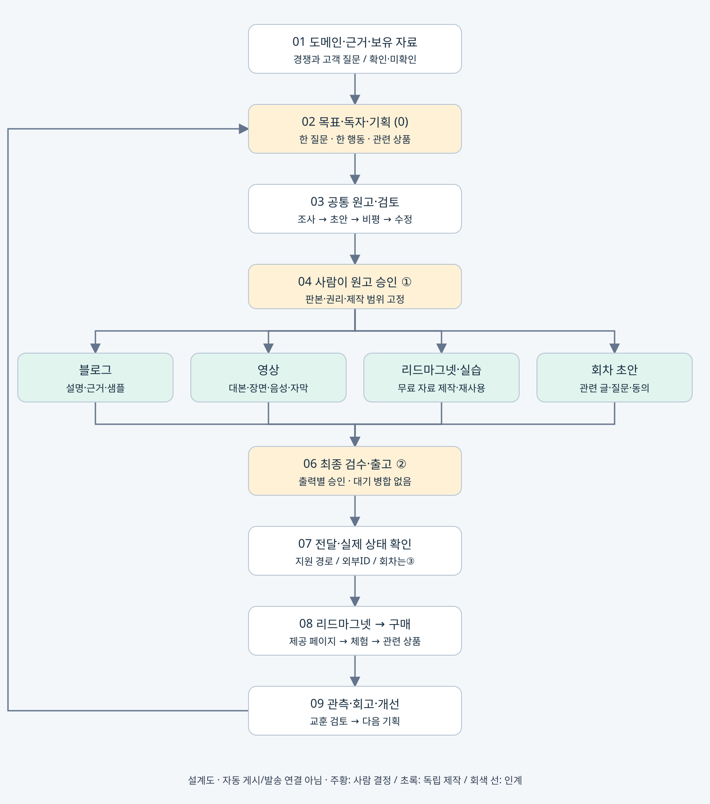

# HeoBrain 콘텐츠 파이프라인 · 리드마그넷 보완

2026-10-29 KST · 공개 검토용 설계 요약. 메인 계획서는 [기존 플레이북](https://heobrain-office-playbook-20261027.ihtwandy0528.chatgpt.site/#content-system)을 유지한다. 이 문서는 로컬 검토 결과를 공개 가능한 범위로 정리한 변경 기록이며 웹·EC2에 새로 배포했다는 뜻이 아니다.

## 목표와 두 콘텐츠 영역

월 **결제 매출 100만 원**을 검증 목표로 둔다. 9,900원 실현가를 가정하면 102건=1,009,800원이다. 가격·전환율·실제 매출은 미검증이며 순이익과 다르다.

- 학습·시험 준비: 연상 단서→가리고 회상→해설→복습으로 학습 행동을 돕는다. 효과를 보장하지 않는다.
- 개인·업무·콘텐츠 생산성: 반복 업무의 입력·결과·검수·실패 복구를 설명한다. 무관한 학습 상품을 강제로 연결하지 않는다.

## 전체 제작 흐름

근거 조사 → 기획 선택⓪ → 공통 원고·별도 검토 → 사람 원고 승인① → 블로그·영상·리드마그넷/실습·회차 초안 독립 제작 → 출력별 출고② → 전달·외부 상태 확인 → 자료 체험·관련 상품 → 회고.

블로그 공개는 영상 제작의 선행조건이 아니다. 선택한 출력만 제작하고 성공 자산은 보존한다. 홍보 발송은 별도 회차③·동의·빈도·철회 상태를 확인한다.

## 리드마그넷을 독립 공정으로 추가

리드마그넷은 독자가 작은 문제를 먼저 해결하도록 돕는 무료 자료다. 콘텐츠를 많이 만드는 것과 자료를 실제로 사용하게 만드는 것을 구분한다.

| 대상 | 첫 무료 자료 제안 | 완료 과업 |
|---|---|---|
| 학습·시험 준비생 | 연상→인출→복습 체험 팩 | 자체 예시 학습·회상·해설·복습 계획 |
| AI 자동화 콘텐츠 독자 | 반복 업무 진단표·작업 브리프·검수표 | 업무 하나의 입력·결과·사람 승인 지점 작성 |

자체 작성한 [AI 자동화 무료 체험 작업표](2026-10-29-ai-automation-workbook.md)는 초안이다. 권리 확인한 자체 자료만 사용하고 타사 강의 화면·문항·프롬프트를 복제하지 않는다.

### 자료 제작과 재사용

1. 기획⓪에 독자 질문·무료 혜택·완료 과업·관련 상품 적합성·주CTA를 정한다.
2. 원고① 후 자료를 제작한다. 파일 열림·모바일 읽기·링크·정답·권리를 검수하고 자료별 출고②를 받는다.
3. 제공 페이지에 대상·얻는 결과·구성·형식·버전·제공 방식을 표시한다.
4. 관련 블로그·영상·카드에서 같은 승인 자료로 연결한다. 게시물마다 다시 만들지 않으며 내용·상품·권리 변경 때 새 판본을 검수한다.

### 독자 여정과 후속 안내

콘텐츠 → 제공 페이지 → 자료 요청 → 전달 확인 → 실제 사용 → 선택적 후속 안내 → 관련 상품 → 실제 결제 → 개선.

직접 다운로드와 요청 메일 전달 중 하나부터 선택한다. 자료 요청과 마케팅 수신 동의는 별도 기록한다. 다운로드가 홍보 동의나 구매를 뜻하지 않으며 이메일 입력을 모든 학습 실습의 필수조건으로 만들지 않는다.

후속 안내 제안은 자료·사용법 → 한 과업 → 적용 예시/한계 → FAQ → 적합한 상품이다. 날짜·빈도는 실험 가설이다. 홍보 회차③와 발송 직전 철회 상태를 확인하고, 실제 제공되는 상품만 연결한다. 별도 승인 없이 쿠폰을 발급하지 않는다.

## 인계·복구·측정

기존 Hermes·Python 엔진·worker·장부·예약을 먼저 재사용한다. campaign_id, lead_magnet_id, 파일 버전/해시, 제공 페이지, request_id, 전달 상태/외부ID, 별도 동의·철회 시각, 승인 참조와 다음 담당을 기존 장부에 추가하는 설계다. 개인정보 수집 전 저장 위치·권한·보관/삭제 기준을 정한다.

응답 유실은 미확인으로 두고 기존 외부ID 조회 후 재시도를 결정한다. 성공 전달은 무조건 반복하지 않고 철회 뒤 대기 홍보는 중단한다.

제공 페이지 세션·요청·전달 확인·관찰된 사용 완료·별도 동의·상품 클릭·유효 유료 결제를 같은 캠페인과 기간에서 따로 기록한다. 요청률=요청 세션/제공 페이지 세션, 전달 성공률=확인 성공 요청/유효 요청으로 정의한다. 메일 열람을 실제 사용으로 간주하지 않고 미측정을0으로 채우지 않는다.

## 초보자용 첫 실행

첫 주에는 모든 도구를 연결하지 않는다. 작업표로 반복 업무 하나를 직접 끝낸 뒤 동의한 시험 독자3~5명의 막힘을 관찰하고 한 곳만 고친다. 소표본으로 전환율·학습 효과를 일반화하지 않는다. 이후 자료 전달 한 경로를 검증하고 후속 안내·상품 연결 순서로 확장한다.

## 기억과 모델 연계의 경계

Hermes의 대화 기록·핵심 기억·현재 작업 장부는 역할이 다르다. Claude·Codex·Gemini가 같은 프로필의 맥락을 받는지, 실제 기억을 저장·검색하는지는 별도 시험이 필요하다. 여러 앱·Windows·EC2의 대화를 자동 통합했다고 주장하지 않는다. 인증 파일·대화 DB·개인 기억 원문은 저장소에 포함하지 않는다.

## 현재 구현·검증·계획·미구현

| 구분 | 범위 |
|---|---|
| 현재 구현 | 설계 문서·자체 도식·무료 작업표 초안 |
| 이번 확인 | 리드마그넷 제작/전달/후속 안내·동의 분리·복구·지표를 설계에 반영. 로컬 HTML 메뉴/파일 연결·모바일 너비 확인 |
| 계획/제안 | 제공 페이지·자료 요청·전달·회차·상품 연결 |
| 미구현/미검증 | 실제 이메일 수집/발송, 고객 효용, 구매 전환·매출 목표 달성, 도구 간 기억 공유 E2E |

## 참고와 공개 범위

- [사용자 지정 워크플로우 참고](https://claude.ai/public/artifacts/0ab18644-5601-41bf-8383-14133c92f92d): 주간·월간·매체별 구조 참고. 도형·문구는 독립 제작했다.
- [Hermes 기억 공식 문서](https://hermes-agent.nousresearch.com/docs/user-guide/features/memory): 핵심 기억과 과거 세션 검색을 구분한다.
- 사용자 제공 일당백 강의 자료는 개인학습용으로 검토했다. 무료 혜택→제공 페이지→요청/전달→후속 안내 개념을 자체 설계로 반영했다. 원문 PDF·캡처·강의 템플릿은 공개하지 않는다. 강의의 전환율·매출 예시는 HeoBrain 실적이 아니다.
